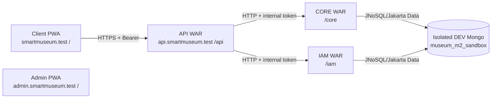

# Smart Museum M2 Implementation Handoff

**Purpose:** Give the next developer a practical, source-linked overview of the
M2 middleware split, local WildFly deployment, HTTPS setup, configuration, and
acceptance evidence.

**Repository branch:** `feature/m2-independent-wars`  
**Recorded implementation:** 2026-11-15  
**Runtime tested:** Java 21, Maven, WildFly 42.0.0.Final, Windows PowerShell  
**Scope:** Middleware modularization and local integration of CORE, IAM, API,
Client, and Admin. This handoff does not claim a production rollout.

## 1. Executive summary

M2 changes the backend from a single deployable application into three
independently deployable WildFly WARs. CORE owns museum domain behavior and
museum collections, IAM owns accounts and identity/security behavior, and API
keeps the PWA-facing REST contract and coordinates with CORE and IAM over
authenticated HTTP. A small Contracts JAR shares request/response types and
the internal-service binding annotation; it is packaged into the WARs and is
not a fourth service.

The Client and Admin PWAs are separate static WARs hosted by WildFly on
different Undertow virtual hosts. The public API has its own host and `/api`
context. CORE and IAM use `/core` and `/iam` internal contexts. For local
development, the public hosts use HTTPS with a current-user-trusted mkcert
certificate and the DEV database is an isolated Mongo container on loopback.

The local runtime acceptance run passed. The rollback drill was explicitly
left untested at the operator's request. Production TLS, production secrets,
production DNS/reverse proxy, and production data integration still need
environment-specific setup.

## 2. Implemented areas and evidence

| Area | Status | Implementation/evidence |
|---|---|---|
| Middleware | Implemented | Three independent WAR deployments; API calls CORE/IAM through HTTP with `X-Internal-Service-Token`. No CDI injection crosses WAR boundaries. |
| Maven | Implemented | Parent aggregator plus Contracts JAR and CORE, IAM, API WAR modules. WAR names are stable. |
| WildFly | Implemented and locally runtime-verified | All five application WARs were reported enabled/`OK` during acceptance. Three service health probes returned HTTP 200 with Mongo `UP`. |
| CLI/deployment scripts | Implemented | PowerShell wrappers deploy each app; CLI files add missing Undertow hosts without overwriting existing resources. Deployment script verifies staging and deployment markers and backs up before replacement. |
| Properties | Implemented | Non-secret DEV settings and DEV/PROD environment templates exist. DEV points at the isolated M2 sandbox. Secrets are local/process values, not checked into templates. |
| Frontend | Implemented | Client and Admin are standalone static WARs. Both API builds use the HTTPS API; see [P3_FRONTEND_AUDIT.md](P3_FRONTEND_AUDIT.md). |
| Domains | Implemented locally | Windows hosts entries resolve `smartmuseum.test`, `admin.smartmuseum.test`, and `api.smartmuseum.test` to loopback on the checked development machine. This is local hosts-file mapping, not public DNS. |
| HTTPS | Implemented and locally browser-verified | WildFly HTTPS listener uses separate environment-backed M2 Elytron resources. Edge loaded all public sites without certificate errors; redirects and Client service worker were verified. |

## 3. Runtime architecture



The Admin PWA is hosted and serves its UI, but its management actions are
currently mock-only and are not connected to the API. Do not describe the
Admin interface as an integrated account/device management console.

### Service responsibilities

- **CORE** owns device discovery and approval state, Thing Descriptions,
  measurements, validation, WoT/domain behavior, and Mongo collections
  `devices`, `measurements`, and `things`.
- **IAM** owns users in collection `users`, login, password verification,
  JWT validation, account-active checks, role checks, and zone authorization.
- **API** owns public JAX-RS resources, HTTP response mapping, CORS, public
  authentication filters, API-to-service HTTP clients, and the unchanged
  external `/api` route prefix.
- **Contracts** owns shared serialized models/errors and the annotation used
  to guard internal service endpoints. It contains no service implementation
  or persistence code.

API is stateless with respect to MongoDB. The API process sends authenticated
HTTP requests to CORE/IAM. Its configuration has `CORE_SERVICE_URL`,
`IAM_SERVICE_URL`, and `INTER_SERVICE_TOKEN`; CORE and IAM validate that shared
service token on internal routes. User Bearer tokens are forwarded to IAM for
identity validation and privileged account provisioning decisions.

## 4. Maven structure and artifacts

Parent POM: [`middleware/pom.xml`](../middleware/pom.xml)

| Module | Maven packaging | Artifact | Responsibility |
|---|---|---|---|
| `contracts` | `jar` | `smart-museum-contracts-1.0.0.jar` | Shared DTO/model/error contracts and internal service annotation |
| `core` | `war` | `smart-museum-core.war` | CORE REST/internal service, domain behavior, Mongo access |
| `iam` | `war` | `smart-museum-iam.war` | IAM REST/internal service, users, JWT, BCrypt, Mongo access |
| `api` | `war` | `smart-museum.war` | Public API and service-to-service HTTP client |

The final API WAR filename intentionally remains `smart-museum.war`. The
context roots are defined in each WAR's `WEB-INF/jboss-web.xml`.

The parent uses Java release 21 and manages Jakarta EE 11, JNoSQL 1.1.20,
Jakarta Data 1.0.2, JJWT 0.12.6, JUnit 5.11.3, and BCrypt 0.4. Jakarta EE and
Jakarta Data APIs are `provided` by WildFly. CORE and IAM package their
required JNoSQL Mongo runtime. IAM packages the JWT implementation/Jackson
runtime and BCrypt. API packages Contracts and does not bundle CORE/IAM
implementations, JNoSQL/Mongo, JWT, BCrypt, or a second Jakarta EE API.

From the repository root in PowerShell:

```powershell
mvn -f middleware/pom.xml clean verify
```

The complete build, including frontend checks and WAR packaging, is:

```powershell
.\deployment\build-all.ps1
```

Expected artifacts:

```text
pwa-client/deployment/target/smart-museum-client.war
pwa-admin/deployment/target/smart-museum-admin.war
middleware/core/target/smart-museum-core.war
middleware/iam/target/smart-museum-iam.war
middleware/api/target/smart-museum.war
```

## 5. WildFly routes, virtual hosts, and public API

| Application | Context | Undertow host resource | Local host / URL |
|---|---|---|---|
| Client PWA | `/` | `smartmuseum-host` | `https://smartmuseum.test/` |
| Admin PWA | `/` | `admin-smartmuseum-host` | `https://admin.smartmuseum.test/` |
| API | `/api` | `api-smartmuseum-host` | `https://api.smartmuseum.test/api` |
| CORE | `/core` | `internal-host` (`internal-server`, 127.0.0.1:8080) | Internal; health can be checked locally at `http://localhost:8080/core/health` |
| IAM | `/iam` | `internal-host` (`internal-server`, 127.0.0.1:8080) | Internal; health can be checked locally at `http://localhost:8080/iam/health` |

Public host HTTP traffic (port 80) redirects to HTTPS on 443 without a port. The public WARs have transport
confidentiality constraints. CORE/IAM service-to-service URLs in local DEV
remain `http://localhost:8080/core` and `http://localhost:8080/iam`; public
clients must not be routed to their internal business endpoints.

### Public endpoint inventory

All paths below are relative to `/api` (for example, `/health` is
`/api/health`). Authentication requirement is the application contract.

| Method | Route | Purpose | Access |
|---|---|---|---|
| GET | `/health` | API and downstream Mongo health | Public health probe |
| POST | `/auth/login` | Issue access token and user DTO | Public; credentials in JSON over HTTPS |
| POST | `/users` | Provision a CLIENT user with zone assignments | ADMIN Bearer token |
| GET | `/devices` | List devices; optional `status` filter | ADMIN sees all; CLIENT restricted to assigned zones |
| GET | `/devices/{deviceId}` | Device detail and TD relation | ADMIN or authorized zone CLIENT |
| POST | `/devices/{deviceId}/approve` | Approve discovered device | ADMIN only |
| POST | `/devices/{deviceId}/reject` | Reject discovered device | ADMIN only |
| GET | `/measurements/latest?zoneId=...` | Latest zone readings | ADMIN or assigned-zone CLIENT |
| GET | `/measurements/history?...` | Device/property history with optional time range and limit | ADMIN or assigned-zone CLIENT |
| POST | `/things` | Register/update device announcement and Thing Description | `X-Service-Token` |
| GET | `/things` | List Thing Descriptions | ADMIN only |
| GET | `/things/{deviceId}` | Get a Thing Description | ADMIN only |
| POST | `/ingest/measurements` | Ingest measurement | `X-Service-Token` |

The device detail response provides a `Link` relation to its Thing Description.
Thing registration includes `Location` and `Link` behavior described by the
existing API contract. Repeated announcement/measurement ingestion has tested
idempotent responses. Invalid measurement domain/schema/affordance data returns
the existing client error/validation responses; unauthorized roles/zones are
denied.

### Internal service routes

CORE routes live below `/core/internal/core/*` and include health, device list
and lookup, approve/reject, latest/history measurements, Thing announcement
and lookup/list, and ingestion operations. IAM routes live below
`/iam/internal/iam/*` and include login, token authenticate, and CLIENT
provisioning. All internal operations require `X-Internal-Service-Token`.
Independent `/core/health` and `/iam/health` probes are available for local
runtime checks; they report service/Mongo status and do not expose internal
business operations.

### Authentication and authorization behavior

- IAM stores passwords as BCrypt hashes (cost 12); account JSON omits the
  password/hash. Email is normalized, and user identifiers are UUIDs.
- Login returns a signed HS256 JWT with issuer, subject, role, issue time, and
  expiry. Default access-token lifetime is 900 seconds.
- Roles are `ADMIN` and `CLIENT`. IAM checks active account and current role
  from storage when validating tokens. A role change or account disablement
  invalidates the old token's authorization.
- CLIENT access is limited to stored zone assignments; an empty assignment
  grants no zone access. The API does not trust zone IDs supplied by the
  browser as authorization.
- ADMIN can list/manage device approval state and create CLIENT accounts.
  Broader user CRUD, account recovery, invitations, refresh tokens, and a full
  Admin console are outside current implementation.
- Node/service ingestion continues to use `INGEST_SERVICE_TOKEN` through
  `X-Service-Token`; a human Bearer token is not a substitute.
- CORS uses exact configured origins. Approved preflight returns the allowed
  method/header/exposed-header fields; an unapproved origin receives 403 and
  no allow-origin response header.

## 6. Properties, secrets, and MongoDB isolation

Templates and non-secret defaults are in:

- `middleware/config/dev.properties`
- `middleware/config/dev.env.example`
- `middleware/config/prod.properties.example`
- `middleware/config/prod.env.example`

The local secret-bearing file is `middleware/config/dev.env`; it is ignored by
Git. WildFly does not load `.env` files automatically. The deployment import
script reads only recognized variable names, validates the selected profile,
clears stale process values, and does not print secret values.

Important variables:

| Variable | Role / expected handling |
|---|---|
| `SMART_MUSEUM_ENV` | Must match `dev` or `prod` startup profile. |
| `JNOSQL_MONGODB_HOST`, `JNOSQL_DOCUMENT_DATABASE` | Database host/name; DEV is `localhost:27018` and `museum_m2_sandbox`. |
| `CORE_SERVICE_URL`, `IAM_SERVICE_URL` | Internal service base URLs; use verified HTTPS URLs and normal trust in production. |
| `INTER_SERVICE_TOKEN` | Random shared API-to-CORE/IAM secret, at least 32 characters; server side only. |
| `INGEST_SERVICE_TOKEN` | Random service-ingest secret, at least 32 characters; server side only. |
| `JWT_SIGNING_KEY_BASE64` | Random Base64 key with at least 32 decoded bytes; server side only. |
| `JWT_ISSUER`, `JWT_ACCESS_TOKEN_SECONDS` | Token issuer and duration (default 900 seconds; bounded by service validation). |
| `CORS_ALLOWED_ORIGINS` | Comma-separated exact browser origins; no wildcards. |
| `BOOTSTRAP_ADMIN_NAME`, `BOOTSTRAP_ADMIN_EMAIL`, `BOOTSTRAP_ADMIN_PASSWORD` | Optional first-run trio; password supplied through protected local input/secret manager and removed after bootstrap. |
| `SEED_DEVICES` | `true` only in isolated DEV; `false` for production. |
| `MQTT_BROKER_URI` | Broker address used in seeded Thing Description forms. |
| `TLS_KEYSTORE_PATH`, `TLS_KEYSTORE_PASSWORD` | Local PKCS#12 listener setup; password only in ignored local environment file/secret store. |

Do not copy local secret values into this handoff, Git, frontend `VITE_*`
variables, console output, or tickets. The files ending in `.example` are
templates and production sample URLs use `.invalid` placeholders; they are not
usable production endpoints.

### MongoDB boundaries

| Module | Collections owned/read/written |
|---|---|
| CORE | `devices`, `measurements`, `things` |
| IAM | `users` |
| API | None; it calls the service owners over HTTP. |

The M2 DEV Compose file is `middleware/docker-compose.m2-sandbox.yml`:

- Container: `museum-m2-sandbox-mongo`
- Host bind: `127.0.0.1:27018` to container `27017`
- Database: `museum_m2_sandbox`
- Persistent volume: `museum-m2-sandbox-data`

This is distinct from the original `museum-mongo`, database `museum`, and
volume `backend_mongo-data`. The original container/volume were preserved and
not used for M2 acceptance. Do not point `dev.env` or the acceptance script at
the original database.

## 7. Local Windows DNS and HTTPS implementation

The local aliases are entries in the Windows hosts file, not public DNS:

```text
127.0.0.1 smartmuseum.test
127.0.0.1 admin.smartmuseum.test
127.0.0.1 api.smartmuseum.test
```

The checked development machine already had them. The repository does not
write the protected hosts file automatically. For a new Windows workstation,
open an elevated PowerShell session and edit it, for example:

```powershell
Start-Process notepad.exe -Verb RunAs -ArgumentList "$env:SystemRoot\System32\drivers\etc\hosts"
```

Add the three lines above, save, and confirm name resolution before browser
tests. A colleague's workstation needs its own hosts entries or an actual DNS
record.

The local certificate is generated by `deployment/prepare-local-https.ps1`
using mkcert and OpenSSL. It includes SANs for the three `.test` names,
`localhost`, and `127.0.0.1`; certificate/key/PKCS#12 files are outside the
repo under `%LOCALAPPDATA%\SmartMuseum\M2-TLS`. mkcert's root CA is trusted in
the current Windows user's trust store. The key/password are not committed.

`deployment/configure-wildfly-https.ps1` configures distinct environment-backed
Elytron resources (`museumLocalDevKS`, `museumLocalDevKM`,
`museumLocalDevSSC`) and points the HTTPS listener at the M2 context. It keeps
the existing `applicationKS`, `applicationKM`, and `applicationSSC` resources.
Before changing `standalone.xml`, the script makes a timestamped, SHA-256
verified backup and refuses to edit while the management listener is up.

Windows Schannel `curl.exe` may report
`CRYPT_E_NO_REVOCATION_CHECK` for the mkcert cert because the local CA has no
revocation endpoint. This is a local revocation lookup limitation, not a
reason to disable certificate validation. Use a normal Edge profile or
OpenSSL with `%LOCALAPPDATA%\mkcert\rootCA.pem` for chain and host checks.

## 8. Deployment scripts and routine workflows

| Script | Purpose |
|---|---|
| `deployment/initialize-dev-environment.ps1` | Creates ignored DEV environment file and random service/JWT keys; can prompt for a bootstrap admin. Refuses overwrite unless rotation is explicitly selected. |
| `deployment/Import-MuseumEnvironment.ps1` | Imports/validates only supported environment settings for the requested profile. |
| `deployment/start-wildfly.ps1` | Starts WildFly with DEV or externally supplied PROD environment; checks profile and ports and clears secrets from the parent PowerShell after the process exits. |
| `deployment/configure-wildfly-hosts.ps1` | Applies PWA/API CLI host scripts; existing host resources are reported and left intact. Requires running WildFly management controller. |
| `deployment/prepare-local-https.ps1` | Generates/reuses local cert and keystore; validates CA, SANs, and keystore without secret output. |
| `deployment/configure-wildfly-https.ps1` | Adds isolated local Elytron TLS resources when absent, after checking WildFly is stopped; backs up config first. |
| `deployment/build-all.ps1` | Runs Client/Admin test/build/package and Maven `clean verify` for middleware, then reports five artifact hashes. |
| `deployment/deploy-core.ps1`, `deploy-iam.ps1`, `deploy-api.ps1` | Per-service deployment entry points. API replacement requires matching verified backup path/hash. |
| `deployment/deploy-middleware.ps1` | Deploys CORE, IAM, API in order. |
| `deployment/deploy-client.ps1`, `deploy-admin.ps1` | Independently replace PWA WARs. |
| `deployment/deploy-all.ps1` | Replaces all five existing deployments; validates the current API matches a verified backup before starting. |
| `deployment/deploy-wildfly-war.ps1` | Shared guarded copy/marker/CLI deployment implementation; backs up before replace and restores prior WAR if deployment fails. |
| `deployment/check-deployments.ps1` | Queries WildFly deployment status. |
| `deployment/rollback-api.ps1` | Guarded API rollback requiring explicit confirmation and expected hash. The runtime rollback drill was not performed. |
| `deployment/test-m2-runtime.ps1` | End-to-end acceptance script; requires explicit `-ConfirmSandboxWrites` and refuses non-sandbox DB targets. |

### Build and initial local run

Required local tools are Docker Desktop with Compose, Node.js/npm, Java 21,
Maven, WildFly 42, mkcert, and OpenSSL. Use Windows PowerShell from the repo
root; `wildflyHome` must point at the actual WildFly installation.

From a PowerShell window at the repo root, start the isolated database and
create local ignored secrets only if `middleware/config/dev.env` does not
already exist:

```powershell
docker compose -f middleware/docker-compose.m2-sandbox.yml up -d
docker inspect museum-m2-sandbox-mongo --format '{{.State.Status}} {{json .NetworkSettings.Ports}}'
.\deployment\initialize-dev-environment.ps1 -CreateBootstrapAdmin
.\deployment\prepare-local-https.ps1
$wildflyHome = 'C:\path\to\wildfly-42.0.0.Final'
.\deployment\configure-wildfly-https.ps1 -WildFlyHome $wildflyHome
.\deployment\build-all.ps1
```

The WildFly TLS configuration must be in place before startup. Start WildFly
in a dedicated PowerShell window, leaving it open:

```powershell
.\deployment\start-wildfly.ps1 -Profile dev -WildFlyHome $wildflyHome
```

Once the management controller is available, create any missing virtual hosts:

```powershell
.\deployment\configure-wildfly-hosts.ps1 -WildFlyHome $wildflyHome
```

For a fresh WildFly directory with no previous deployments, deploy the five
WARs individually with the wrappers, omitting `-ReplaceExisting` for absent
deployments. API deployment still requires a verified old API WAR artifact
and its hash for rollback. For the already-populated M1/M2 environment, take a
SHA-256-verified copy of the currently deployed `smart-museum.war` before an
API replacement and use `deploy-all.ps1` only when all its expected current
Client/Admin/API deployments exist. See `deployment/README.md` for the full
replacement command. Never skip the API backup/hash check.

The deployment scripts stage the WAR in the WildFly deployment directory,
verify the copied SHA-256, remove stale deployment markers, and wait for
WildFly success/failure markers or management status (up to 120 seconds). On
failure with a prior deployment, the script restores its verified saved WAR.

### Manual checks

```powershell
.\deployment\check-deployments.ps1 -WildFlyHome $wildflyHome
```

Open the API, CORE, and IAM health URLs in the trusted browser for manual
health checks. Windows Schannel curl can fail its revocation lookup for this
local CA; do not bypass certificate validation. The acceptance script uses
OpenSSL with strict chain and hostname verification.

Expected health payloads contain `"status":"UP"` and `"mongo":"UP"`.
Browser URLs are Client `https://smartmuseum.test/`, Admin
`https://admin.smartmuseum.test/`, API
`https://api.smartmuseum.test/api/health`. Confirm the Client manifest,
activated service worker, API health fetch, and absence of browser TLS, CORS,
and mixed-content errors.

The full runtime suite is:

```powershell
.\deployment\test-m2-runtime.ps1 -ConfirmSandboxWrites
```

This is a write test: it creates test accounts/Things/measurements in
`museum_m2_sandbox` and leaves records there. Run it only when DEV is verified
to point to the isolated sandbox. It uses the protected local acceptance
administrator credential file under `%LOCALAPPDATA%\SmartMuseum\M2-TLS`;
never copy that file or its secret contents to colleagues.

## 9. Runtime acceptance evidence

The recorded result is also in
[`middleware/M2_RUNTIME_ACCEPTANCE.md`](../middleware/M2_RUNTIME_ACCEPTANCE.md).

- `deployment/build-all.ps1` passed. Recorded counts: Client Node 40, Client
  Vitest 10, Admin Vitest 13, and middleware Maven 47 (CORE 33, IAM 9, API 5),
  with no reported failures or skips.
- All five WARs were generated and inspected. API WAR did not contain the
  service implementations or persistence/security runtime libraries.
- Runtime acceptance reported five WildFly deployments enabled/`OK` and all
  three service health checks HTTP 200 with Mongo `UP`.
- The acceptance script passed the authenticated API flows, invalid/expired
  token denials, role and zone boundaries, CORS allow/deny behavior, internal
  token enforcement, Thing registration, and measurement ingestion/validation.
- Client production bundle used
  `https://api.smartmuseum.test:8443/api`, and Edge confirmed secure context,
  manifest MIME, activated service worker, and API connectivity.
- `museum_m2_sandbox` contains test records from the acceptance run. The
  original `museum` database and its container/volume were not targeted.
- API approval/rejection had a runtime mismatch fixed from GET to POST in the
  API-to-CORE client; CORS preflight was also corrected and rechecked.

**Not completed:** rollback drill, production environment rollout, production
DNS/TLS/reverse proxy, Admin-to-API integration, and any broader M3/M4 scope.
Backups and guarded rollback tooling exist, but rollback behavior itself must
remain labelled unverified until a separate drill is completed.

## 10. Change history and handoff notes

The M2 implementation was grouped into these local commits (not a release
tag):

```text
d0caced refactor(middleware): split core and iam into independent modules
af80e36 feat(api): integrate modular services and secure public endpoints
fdf9769 feat(deployment): automate modular WildFly deployment and HTTPS
393aca7 fix(pwa): configure production API integration and deployment
c5bb41d docs(m2): document deployment and runtime acceptance
```

The current Windows hosts-file entries, certificate trust store, WildFly
installation, ignored `dev.env`, acceptance credentials, and M2 Mongo volume
are machine-local. A colleague must create their own local environment and
certificates. Do not share the local keystore/private key, the dev environment
file, tokens, JWT signing key, bootstrap password, or acceptance credentials.

Before any future API deployment, inspect the live WildFly deployment and
make/hash a fresh backup of the API WAR that is currently deployed. The M2
rollback drill remains untested. Production-like external exposure should be
designed separately, including reverse proxy routing that excludes CORE/IAM
internal routes.
