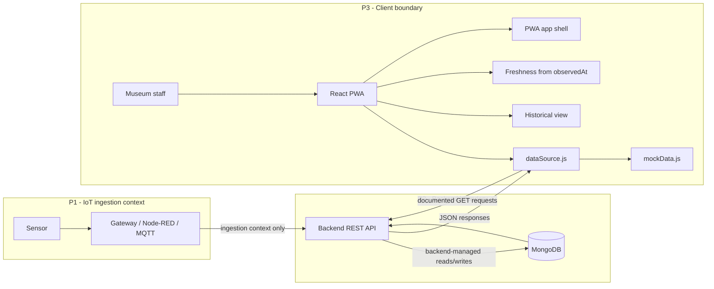
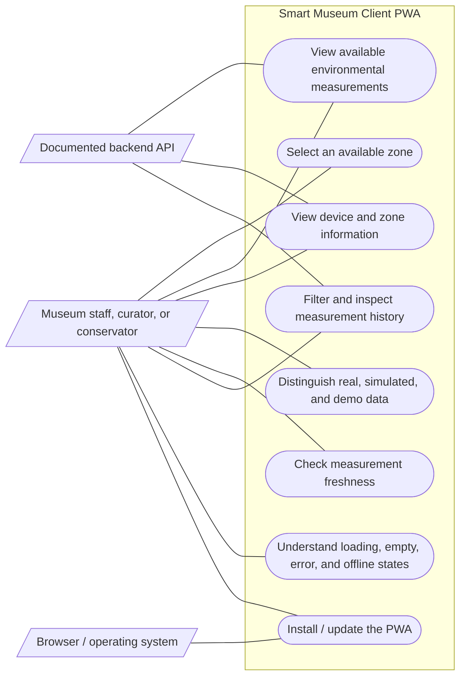
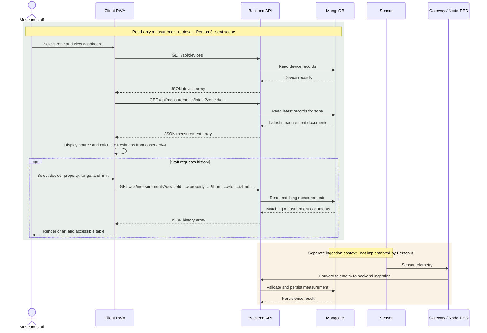
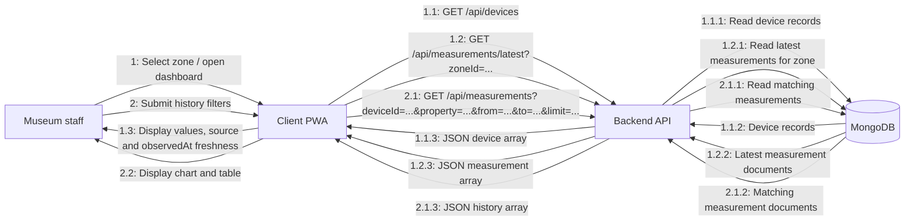

# Smart Museum - Person 3 Frontend PWA Technical Handoff

**Project:** Smart Museum - Cultural Heritage Monitoring System  
**Document:** Person 3 - Frontend PWA Technical Handoff  
**Role:** P3 - Client Application / Frontend  
**Technology:** React 19 and Vite 7  
**Version:** 1.0  
**Prepared:** 2 November 2026  
**Audience:** Person 1 (IoT/Node-RED), Person 2 (Jakarta EE backend), project team, and professor

> **Verification status:** This document describes the source in `pwa-client/`.
> P2 source and OpenAPI behavior were inspected on the `sirine-week-1` branch
> reference and are source-level compatible with the P3 read client. Live API
> responses and browser CORS are not verified: `localhost:8080` was not
> reachable during endpoint and preflight probes.

<div class="page-break"></div>

## Contents

1. [Project context](#1-project-context)
2. [P3 scope and completed deliverables](#2-p3-scope-and-completed-deliverables)
3. [Technical architecture](#3-technical-architecture)
4. [Repository structure and important files](#4-repository-structure-and-important-files)
5. [Installation and local execution](#5-installation-and-local-execution)
6. [API integration contract and backend expectations](#6-api-integration-contract-and-backend-expectations)
7. [Mock data and demonstration behavior](#7-mock-data-and-demonstration-behavior)
8. [Data freshness and refresh behavior](#8-data-freshness-and-refresh-behavior)
9. [PWA implementation](#9-pwa-implementation)
10. [Testing and quality assurance](#10-testing-and-quality-assurance)
11. [UML and technical diagrams](#11-uml-and-technical-diagrams)
12. [Known limitations and pending decisions](#12-known-limitations-and-pending-decisions)
13. [Integration procedure against a running P2 backend](#13-integration-procedure-against-a-running-p2-backend)
14. [Handoff summary and responsibilities](#14-handoff-summary-and-responsibilities)

---

<div class="page-break"></div>

## 1. Project context

Smart Museum is a cultural-heritage monitoring project intended to give
museum personnel environmental context for exhibition areas and collections.
Temperature, humidity, pressure, and illuminance are environmental properties
that a conservation team may review when caring for artifacts. The PWA
displays measurements only when records are available; it does not assess
conservation compliance or make preservation recommendations.

The client-facing Progressive Web App (PWA) provides a responsive browser
interface for staff, curators, and conservation personnel. It can run in
demonstration mode without the backend. Its API mode is prepared for the
documented read endpoints but has not been tested against a live backend.

### Team boundaries

| Owner | Project responsibility | P3 boundary |
|---|---|---|
| P1 | Sensors, gateway/edge environment, Node-RED and IoT-side telemetry flow | P3 consumes read results; it does not configure sensors, MQTT, gateways, or ingestion. |
| P2 | Jakarta EE backend, persistence, and shared API contract | P3 calls the documented read endpoints only. P3 does not implement the backend, database, or API contract. |
| P3 | React client PWA and frontend/conceptual documentation | Dashboard, mock-mode development, API client boundary, client-side presentation, and PWA shell. |

Measurement **ingestion** and PWA **retrieval** are separate flows. The
conceptual ingestion path is sensor -> gateway/Node-RED -> backend -> MongoDB.
The PWA read path is browser/PWA -> backend REST API -> MongoDB read handled by
the backend -> API response -> browser/PWA. P3 owns only the browser client.

## 2. P3 scope and completed deliverables

The following implementation is present in the inspected source. "Implemented"
describes frontend behavior and does not imply a verified live backend.

| Feature | Behavior in the client | Main implementation |
|---|---|---|
| Dashboard and navigation | Smart Museum sidebar, dashboard heading, responsive content, section anchors, connection indicators | `src/pages/ConservationDashboard.jsx`, `src/components/Sidebar.jsx`, `src/styles/main.css` |
| Zone selection | Mock mode uses the documented examples; API mode derives and deduplicates zones from returned device records. Latest-data effect reruns for the selected zone. | `ConservationDashboard.jsx`, `src/services/dataSource.js` |
| Measurement cards | Renders property groups with value, unit, `observedAt`, device, zone, source, optional gateway/quality, and freshness where fields exist | `src/components/MeasurementCard.jsx`, `src/utils/measurementData.js` |
| Environmental properties | Supports `temperature`, `humidity`, `pressure`, and `illuminance`; only returned properties are rendered | `measurementData.js`, `ConservationDashboard.jsx` |
| Device and zone information | Shows all devices returned for the selected zone and available IDs/gateway/source. In API mode, raw `status` and `lastSeenAt` are shown only when supplied; no online/offline semantics are inferred. | `src/components/ZoneDetails.jsx` |
| Data provenance | Separates `real` and `simulated` source labels from the prominent mock/demo label. A mock record with `source: real` remains demonstration data. | `src/components/StatusMessage.jsx`, `MeasurementCard.jsx`, `mockData.js` |
| Freshness | Computes freshness from measurement `observedAt`; invalid, future, or absent timestamps do not appear current | `src/utils/measurements.js`, `FreshnessIndicator.jsx`, `ConservationDashboard.jsx` |
| Automatic refresh | Starts an immediate read and repeats at a configurable interval; prevents overlapping runs and cleans up on unmount | `src/services/refreshScheduler.js`, `ConservationDashboard.jsx` |
| Historical measurements | Zone/device/property/date-time/limit filters; SVG chart plus accessible HTML table; result labels remain attached to the submitted query | `src/components/HistoricalMeasurements.jsx`, `HistoryChart.jsx`, `src/utils/historyChart.js` |
| Alerts | Placeholder only. It does not retrieve or generate alerts. | `src/components/AlertsPlaceholder.jsx` |
| Error and offline states | Separates API connection state, browser online/offline state, loading/empty/error states, and measurement freshness | `StatusMessage.jsx`, `PwaControls.jsx`, `HistoricalMeasurements.jsx` |
| PWA shell | Manifest and icons, production service-worker registration, app-shell cache, offline navigation response, install prompt and user-controlled update | `src/main.jsx`, `public/manifest.webmanifest`, `public/service-worker.js`, `public/offline.html`, `PwaControls.jsx` |
| Documentation and diagrams | P3 guide and editable Mermaid use-case, retrieval/ingestion sequence, and communication sources | `DOCS/pwa-client.md`, `DOCS/diagrams/*.mmd` |

### Explicitly not delivered

There is no backend implementation, sensor/gateway integration, ingestion
client, alert API, authentication flow, role management, analytics, prediction,
or anomaly detection in the P3 frontend. No service token or ingestion
credential belongs in browser code.

## 3. Technical architecture

### Frontend structure and data flow

The app is a JavaScript React 19 single-page application built and served by
Vite 7. `src/main.jsx` mounts `App`; `App` renders the conservation dashboard.
The dashboard selects a zone and data mode, requests data through
`src/services/dataSource.js`, and composes reusable components. UI components
do not make their own HTTP requests.



### Responsibilities of the frontend modules

1. `ConservationDashboard.jsx` holds the selected zone and mode, schedules
   latest-data retrieval, exposes request/connection states, groups
   measurements, calculates freshness, and arranges dashboard sections.
2. `dataSource.js` selects mock or API behavior. The API path retrieves the
   device list, derives available zones, then retrieves the latest measurement
   array for the selected zone when a matching device exists. The history path
   delegates to the central API client or filters existing demo fixtures.
3. `api.js` centralizes base URL, GET requests, timeouts, JSON parsing,
   response validation, cancellation, query encoding, and API error types.
4. `measurementData.js`, `measurements.js`, and `historyChart.js` prepare
   property metadata, source timestamps/freshness, and chart points without
   mutating the API records.
5. Components render the resulting state. `HistoricalMeasurements.jsx`
   sends a history query on explicit form submission and renders an SVG chart
   and a table.

### System boundary

The PWA does not communicate directly with MongoDB or IoT hardware. In the
documented system context, P1 supplies telemetry through its IoT/gateway path.
P2 owns API persistence and read behavior. The browser issues only the
documented GET operations. The architecture diagram's ingestion arrows are
context, not P3 code.

## 4. Repository structure and important files

The following tree excludes `node_modules/` and generated `dist/` output.

```text
pwa-client/
  .env.example
  index.html
  package.json
  package-lock.json
  vite.config.js
  vitest.config.js
  public/
    manifest.webmanifest
    offline.html
    service-worker.js
    icons/
      museum-mark.svg
      museum-mark-192.png
      museum-mark-512.png
  src/
    App.jsx
    main.jsx
    components/
      AlertsPlaceholder.jsx
      FreshnessIndicator.jsx
      HistoricalMeasurements.jsx
      HistoryChart.jsx
      MeasurementCard.jsx
      PwaControls.jsx
      Sidebar.jsx
      StatusMessage.jsx
      ZoneDetails.jsx
      history-dashboard.component.test.jsx
    pages/
      ConservationDashboard.jsx
    services/
      api.js
      api.test.js
      dataSource.js
      dataSource.test.js
      mockData.js
      pwa.test.js
      refreshScheduler.js
      refreshScheduler.test.js
    styles/
      main.css
    utils/
      historyChart.js
      historyChart.test.js
      measurementData.js
      measurementData.test.js
      measurements.js
      measurements.test.js

DOCS/
  pwa-client.md
  P3_Technical_Handoff_Smart_Museum.md
  diagrams/
    pwa-use-cases.mmd
    pwa-measurement-sequence.mmd
    pwa-communication.mmd
    Smart_Museum_P3_Diagrams.pdf
```

### Important file responsibilities

| File(s) | Responsibility and dependencies |
|---|---|
| `pwa-client/package.json`, `package-lock.json` | Scripts and locked React/Vite/Vitest/Testing Library dependencies; `npm ci` reproduces the lockfile. |
| `pwa-client/.env.example` | Non-secret local defaults for data mode, API URL, timeout, freshness, and refresh. |
| `pwa-client/vite.config.js`, `vitest.config.js` | Vite React build configuration and Vitest jsdom component test configuration. |
| `pwa-client/index.html` | Browser document metadata, app icons, manifest link, and React root element. |
| `src/main.jsx`, `src/App.jsx` | Mounts React and renders `ConservationDashboard`; production-only service-worker registration and update lifecycle are in `main.jsx`. |
| `src/pages/ConservationDashboard.jsx` | Main composition, zone/mode state, refresh effect, freshness summary, and connection status. |
| `src/components/Sidebar.jsx`, `StatusMessage.jsx`, `ZoneDetails.jsx`, `AlertsPlaceholder.jsx` | Navigation; loading/demo/error messaging; device details; alert placeholder. |
| `src/components/MeasurementCard.jsx`, `FreshnessIndicator.jsx` | Measurement values/metadata and aggregate freshness display. |
| `src/components/HistoricalMeasurements.jsx`, `HistoryChart.jsx` | History form/query state, responsive chart, and accessible data table. |
| `src/components/PwaControls.jsx` | Browser online/offline listeners, install prompt, and update action. |
| `src/services/api.js` | Central REST client for health, devices, latest measurements, and history. |
| `src/services/dataSource.js`, `mockData.js` | Data-mode boundary and the two documented demonstration devices/fixture records. |
| `src/services/refreshScheduler.js` | Immediate/interval scheduler with in-flight overlap prevention. |
| `src/utils/measurements.js` | Freshness threshold, refresh interval, freshness states, and timestamp formatting. |
| `src/utils/measurementData.js`, `historyChart.js` | Property grouping/metadata and SVG plotting coordinates. |
| `src/styles/main.css` | Visual system, responsive layout, and narrow-screen presentation. |
| `public/manifest.webmanifest`, `public/icons/*` | Install metadata and launcher icon assets. |
| `public/service-worker.js`, `public/offline.html` | Static app-shell caching and navigation fallback. API responses are excluded. |
| `src/services/*.test.js`, `src/utils/*.test.js` | Node built-in tests for services, utility behavior, and PWA assets. |
| `src/components/history-dashboard.component.test.jsx` | Vitest/Testing Library tests of history labels, zone switching, and data-mode controls. |
| `DOCS/pwa-client.md` | User-facing P3 architecture, configuration, API boundary, and operating guide. |
| `DOCS/diagrams/*.mmd` | Editable use-case, sequence, and communication diagrams. |
| `DOCS/P3_Technical_Handoff_Smart_Museum.md` | Editable source for this handoff. |

## 5. Installation and local execution

### Prerequisites

- Node.js 20.19+ or 22.12+ as stated in `pwa-client/README.md`.
- npm.
- A modern browser. Production service-worker tests require a secure context:
  HTTPS or localhost.

### Commands (PowerShell)

```powershell
cd "C:\Users\souro\Desktop\MBK project\pwa-client"
npm ci
Copy-Item .env.example .env
npm run dev
```

Use the local address printed by Vite. Its default development origin is
`http://localhost:5173`; Vite can select another port if that port is in use.
The actual printed origin is the one that must be allowed by backend CORS.

Run checks and production preview:

```powershell
npm test
npm run build
npm run preview
```

The `test` script runs `node --test` followed by
`vitest run --config vitest.config.js`. `build` runs `vite build`; `preview`
serves the generated `dist/` bundle. There is no configured lint script.

### Environment variables

All `VITE_*` values are public client build-time configuration; they are not
secret storage.

| Variable | Example/default | Purpose |
|---|---|---|
| `VITE_DATA_MODE` | `mock` | Initial mode. Only the exact value `api` selects API mode; otherwise the app defaults to mock mode. The in-app controls can switch modes for the current session. |
| `VITE_API_BASE_URL` | `http://localhost:8080` | API origin; the central API module trims trailing slashes. |
| `VITE_API_TIMEOUT_MS` | `10000` | Request timeout in milliseconds. |
| `VITE_STALE_AFTER_MS` | `900000` | Measurement freshness threshold in milliseconds; must be positive. |
| `VITE_REFRESH_INTERVAL_MS` | `15000` | Latest-data refresh period in milliseconds; valid range is 10000-30000 inclusive. |

After changing `.env`, restart the Vite development server. Never add
credentials, `X-Service-Token`, or ingestion secrets to these variables.

## 6. API integration contract and backend expectations

The client uses the documented local backend base URL
`http://localhost:8080`, configurable through `VITE_API_BASE_URL`. Requests
are centralized in `src/services/api.js`; components do not construct API
URLs. The client sends GET requests with an `Accept: application/json`
header and does not add authentication or service-token headers.

### Endpoints currently exposed by the API client

| Method and path | Parameters | Expected response / current use |
|---|---|---|
| `GET /api/health` | None | P2 source returns `{status: "UP", mongo: "UP"|"DOWN"}`. The helper exists and is unit-tested; the dashboard status indicator does not call it. |
| `GET /api/devices` | None | P2 source returns a JSON array with device identity/zone and optional gateway, status, and last-seen data. P3 validates the array and required `deviceId`/`zoneId`, and displays supplied status/time without interpreting them. |
| `GET /api/measurements/latest?zoneId=...` | Required `zoneId` | P2 source returns a JSON array with latest records per device/property pair. P3 uses that array for selected-zone dashboard data. |
| `GET /api/measurements` | Required `deviceId`, `property`; optional `from`, `to`, `limit` | P2 source accepts ISO time bounds, defaults limit to 1000, caps at 5000, and sorts by ascending `observedAt`. P3 encodes only these documented parameters; a supplied limit must be 1–5000. |

The API service rejects non-2xx responses, network failures, request/body
timeouts, invalid JSON, and invalid measurement arrays with explicit errors.
It supports caller cancellation. Non-2xx JSON bodies shaped as
`{error, message}` are retained as structured error metadata; only a
safe-format error code and the generic HTTP failure are displayed, not the
backend message.
In API mode, the device list is read before the zone-specific latest endpoint;
if no returned device belongs to the selected zone, the client does not issue
the latest request.

### Measurement fields and client validation

The documented measurement properties are `temperature`, `humidity`,
`pressure`, and `illuminance`. The client preserves the received field names
and timestamps.

| Field | Client expectation/handling |
|---|---|
| `measurementId` | Required string by current response validator; used as a React key when available. |
| `deviceId` | Required string; shown in cards, device area, and history. |
| `zoneId` | Required string; used to filter/display selected-zone readings. |
| `gatewayId` | Optional string; displayed when present. |
| `property` | Required string; known properties receive labels; unknown values remain identifiable without invented meanings. |
| `value` | Required finite number by current response validator. |
| `unit` | Required string by current response validator; API-provided units are retained for measurement display. |
| `observedAt` | Required parseable timestamp in the current API validator; used for freshness and chart ordering. |
| `source` | Required to be `real` or `simulated` by the current validator. In mock mode, it is still demo data. |
| `quality` | Optional; current accepted values are `good`, `uncertain`, and `bad`. |
| `receivedAt` | Optional parseable timestamp; preserved by validation but not used to calculate freshness. |

The source-level audit confirmed that `latest` returns an array with the
latest record per device/property pair. The frontend handles that shape and
the measurement fields described above. The backend device model includes
`deviceId`, `type`, `zoneId`, `gatewayId`, `status`, and `lastSeenAt`.
Measurements preserve `measurementId`, `deviceId`, `zoneId`, optional
`gatewayId`, `property`, `value`, `unit`, `observedAt`, optional `receivedAt`,
`source`, and optional `quality`.

### API contract items requiring confirmation from P2

The P2 source-level audit confirmed the documented paths, array response
shapes, measurement fields, history query names/limits/sorting, and open
development read endpoints. The default CORS allowlist includes the documented
`http://localhost:5173` origin. These are source-level findings, not live
browser verification. Endpoint probes for health, devices, latest in both
zones, history, and OPTIONS preflight all failed with curl error 7 because
`localhost:8080` was not accepting connections. Browser CORS and actual
responses remain unverified. The API client tests use mocked Fetch responses
only. Never put `X-Service-Token` in the browser; it is an ingestion-side
concern, not a PWA credential.

## 7. Mock data and demonstration behavior

`src/services/mockData.js` is the isolated fixture source. It contains two
devices, four measurement properties per device, and a top-level
demonstration label:

| Device | Zone | Gateway | Fixture `source` |
|---|---|---|---|
| `bme280-01` | `salle-01` | `gw-01` | `real` |
| `sim-bme280-02` | `salle-02` | `gw-sim` | `simulated` |

The example property/unit pairs are temperature/°C, humidity/%, pressure/hPa,
and illuminance/lx. Values and timestamps in this file are illustrative only;
they are **not actual sensor observations**. Every dashboard view in mock
mode also displays a demonstration label, including records whose `source`
field is `real`.

Mock history applies the selected device, property, optional date range, and
limit to the same fixed fixtures. It sorts matching fixture records by
`observedAt`; it does not generate a time series or invent historical
measurements. The fixture's illuminance attribution to `bme280-01` is
unchanged and awaits confirmation from P1/P2. The architecture reference's
mention of a BH1750 does not establish that device mapping.

## 8. Data freshness and refresh behavior

Freshness is based on the source observation timestamp `observedAt`, not the
browser request/fetch time. A successful refresh of an old measurement does
not make that measurement current.

| Setting/state | Actual behavior |
|---|---|
| Default stale threshold | `VITE_STALE_AFTER_MS=900000` (15 minutes). A configured value must be positive. |
| Default refresh interval | `VITE_REFRESH_INTERVAL_MS=15000` (15 seconds); accepted values range from 10 to 30 seconds. |
| Up to date | The UI label for internal freshness state `fresh`, when all displayed measurements have valid, non-future timestamps within the threshold. |
| Stale | At least one valid measurement is older than the threshold. Cards call this “Stale · last known reading.” |
| Unavailable | No measurements exist, or at least one timestamp is absent, invalid, or in the future. |

The scheduler runs once immediately, then on its configured interval. If a
refresh has not completed, another scheduled refresh is skipped. The
dashboard effect stops the scheduler and aborts its active API request when
zone/mode changes or the component unmounts. A separate five-second clock
updates the displayed freshness as time passes. Errors are surfaced as API
errors; they do not turn an earlier observation into a fresh one.

P2's ingestion source permits observations up to five minutes in the future;
P3 currently marks any future `observedAt` as unavailable. This conservative
frontend policy is unchanged. Recommendation: retain the UI's unavailable
state so future timestamps are never presented as current, and treat P2's
five-minute allowance as clock-skew tolerance unless P2 confirms otherwise.
The team must decide before changing the P3 rule.

## 9. PWA implementation

### Manifest and installation

`public/manifest.webmanifest` declares the application and short name
“Smart Museum”, relative `./` start URL and scope, standalone display, theme
color `#183c34`, background `#f4f3ee`, and SVG/192px/512px icons (including a
maskable PNG reference). `src/main.jsx` registers the service worker only in
the production build and only when the browser supports service workers.

`PwaControls.jsx` listens for browser online/offline and install-prompt
events. The **Install app** button appears only if the browser emits
`beforeinstallprompt`; the browser may instead provide its own install menu.
Native installation is browser/platform dependent.

### Service worker and offline behavior

`public/service-worker.js` precaches the built application entry, referenced
JavaScript/CSS assets, manifest, offline page, and icons. It uses a
network-first strategy for same-origin navigations, then falls back to the
cached app entry and, if that is absent, `offline.html`. Same-origin scripts
and styles use a cache-first lookup with a network fallback.

Requests to `/api/`, cross-origin requests, non-GET requests, and requests
with an `Authorization` header are outside the worker's cache handling.
Responses with `private` or `no-store` cache directives are also excluded
when saving app responses. Measurement/API responses are not persisted by
this worker. Already-loaded readings may remain in page memory until
navigation/reload; their freshness continues to use `observedAt`.

A waiting worker announces an update. The user selects **Update app** to send
`SKIP_WAITING`; the page reloads on `controllerchange`. The service worker
checks for updates after page load. In development mode, the production
service worker is not registered.

### Verification and limitations

- Automated tests parse the manifest, check its single `id`, app identity,
  icon sizes, and existence/content of `offline.html`.
- A production preview and service-worker behavior have been recorded as
  manually checked in prior P3 QA notes.
- Physical-device installation has **not** been verified.
- The standalone `offline.html` fallback is present and unit-tested as a
  static file, but it was not independently forced as the displayed page in
  the recorded manual browser run.
- A first visit requires a successful online app-shell load before the shell
  can work offline.
- The app does not cache or display stored API readings as live data.

## 10. Testing and quality assurance

The following automated checks were run for this handoff on 2 November 2026.

| Check | Result | Scope |
|---|---|---|
| `npm test` | **Passed: 33 Node tests and 6 React component tests** | Includes API error parsing, device/zone handling, safe error display, and empty-device behavior. |
| `npm run build` | **Passed** | Vite production build; 46 modules transformed. |
| `node --check public/service-worker.js` | **Passed** | Service-worker JavaScript syntax. |
| `npm audit --offline` | **Passed: 0 vulnerabilities reported** | Current dependency tree and available local audit data. |
| Manifest validation | **Passed through `pwa.test.js`** | Valid JSON, exactly one `id`, expected install fields and PNG dimensions. |

Automated coverage includes:

- API GET endpoints, URL parameter encoding, measurement array validation,
  device field preservation, structured errors, and HTTP/network/timeout/
  invalid-JSON errors.
- Mock device/zone filtering, API-derived deduplicated zones, and history
  filtering/ranges/limits.
- Measurement grouping, unknown-property handling, optional metadata, and
  history chart point ordering.
- Recent/stale/invalid/future/missing timestamp behavior and refresh interval
  validation/overlap prevention.
- Manifest and offline-page assertions.
- Component behavior for history labels, zone changes, API-derived zone/device
  status fields, empty API devices, and data-mode controls.

The API tests mock Fetch; they are not end-to-end integration tests. Browser
requests to the actual backend, actual CORS, and physical-device installation
are unverified.

### Manual QA results on record

The existing P3 QA notes report production-preview checks including a 360px
viewport, active service worker, visible offline state, app-shell-only
caching, and user-triggered worker update activation. The prior QA result
records no page-level horizontal overflow at 360px, 768px, and 1440px. Those
browser checks were **not rerun as part of generating this document**.

The install prompt is browser controlled; physical installation was not
verified. There is no configured lint script.

## 11. UML and technical diagrams

The editable Mermaid sources are in `DOCS/diagrams/`. They describe the
client's documented scope only:

| Diagram | Participants/content | Source |
|---|---|---|
| System architecture | P1 telemetry context, P2 backend/database boundary, and P3 browser/API read path | Architecture diagram in Section 3 of this document. |
| Use cases | Staff and browser interactions with implemented PWA functions and documented API reads | `diagrams/pwa-use-cases.mmd` |
| Sequence | PWA measurement retrieval, with sensor/gateway/Node-RED ingestion shown separately as context | `diagrams/pwa-measurement-sequence.mmd` |
| Communication | Numbered PWA/API/MongoDB messages for dashboard and history retrieval | `diagrams/pwa-communication.mmd` |

The sequence source currently declares MongoDB using Mermaid's `database`
keyword. The Mermaid CLI version available during PDF generation rejects that
declaration. The source remains untouched; the PDF renderer used a temporary
compatible participant declaration for that page only. The editable source
and generated graphic therefore have this known rendering difference.

### Use-case diagram



### Measurement retrieval and separate ingestion sequence



### Numbered communication diagram



## 12. Known limitations and pending decisions

| Issue/decision | Owner | Why it matters | Required action | Status |
|---|---|---|---|---|
| Physical illuminance device attribution | P1/P2 | The demo fixture associates illuminance with `bme280-01`; the architecture reference mentions BH1750 but does not confirm the record mapping. | Confirm sensor identity and device/zone attribution; then update fixtures/documentation if agreed. | Pending |
| Device status semantics | P2 | Device model has `status` and `lastSeenAt`; P3 renders supplied values neutrally. | Confirm meanings/allowed values before adding any online/offline labels. | Pending |
| Backend live availability | P2 | Source-level routes and DTOs were audited, but no service was reachable at `localhost:8080`. | Start a backend instance and provide its startup/configuration details for live testing. | Pending |
| Shared OpenAPI contract | P2 | Backend branch source and its OpenAPI description were audited; live behavior is unverified. | Confirm the merged `contracts/openapi.yaml` remains aligned with source and the P3 validators. | Pending |
| Response shapes and measurement fields | P2 | Source audit found expected arrays and measurement/device fields compatible. | Verify actual responses when service is running, including nullable optional values and error bodies. | Pending |
| History ordering/limits | P2 | Source supports ascending `observedAt`, default 1000, maximum 5000. | Confirm these results from a running service and empty-range behavior. | Pending |
| CORS | P2 | Source default allows `http://localhost:5173`; the OPTIONS request could not connect. | Verify browser requests and preflight from the actual Vite/deployed origins. | Pending |
| Authentication | P2 | Inspected development read endpoints are open; P3 sends no credentials. | Confirm any change before deployment; never expose ingestion token. | Pending |
| Real backend integration | P2/P3 | All current endpoint and preflight probes failed with curl error 7 (connection refused). | Start backend, set API URL/mode, then verify actual browser responses and errors. | Pending |
| Physical PWA installation | P3 | Install prompt/platform behavior is browser-specific. | Verify installation on a supported physical device/browser. | Pending |
| Final API documentation | P3 after P2 confirmation | Frontend docs must reflect the agreed contract rather than assumptions. | Update handoff and P3 guide after contract review. | Pending |

## 13. Integration procedure against a running P2 backend

1. Use the team's agreed integration checkout; do not switch branches or
   overwrite teammate work as part of this P3 handoff.
2. Recheck P2's backend source, startup guide, and merged
   `contracts/openapi.yaml` at the integration revision.
3. Compare endpoint paths, response arrays, fields, optional/null values,
   limits, sorting, health response, and error bodies with `src/services/api.js`.
4. Start MongoDB and the backend using P2's instructions; do not assume
   commands or deployment configuration that P2 has not supplied.
5. Check backend health and each documented read endpoint. Verify actual
   device, latest, and history response bodies and status codes.
6. Set `.env` to the real `VITE_API_BASE_URL` and `VITE_DATA_MODE=api`.
   Keep all credentials and ingestion tokens out of frontend variables.
7. Restart Vite and record the actual origin printed in the terminal.
8. Confirm P2's CORS allowlist for that exact origin and the intended deployed
   PWA origin; the default localhost origin has not been browser-tested.
9. Open browser Network and Console panels. Check health/devices/latest/history
   requests, status codes, JSON parsing, and CORS preflight/error behavior.
10. Test both zones, optional metadata, empty data, invalid fields, API errors,
    history date filters/limits, offline state, and stale timestamps.
11. Run `npm test` and `npm run build`; add tests only for confirmed behavior
    and keep API contract changes documented.
12. Update `DOCS/pwa-client.md` and this handoff with confirmed contract,
    CORS, and verification results.

## 14. Handoff summary and responsibilities

### Delivered by P3

- Responsive React/Vite dashboard with zone selection, measurement/device
  presentation, provenance labels, freshness status, and history view.
- Mock fixtures and a centralized, configurable API client for documented
  read-only endpoints.
- PWA manifest, icons, app-shell service worker, offline experience, and
  browser-controlled install/update UI.
- Automated service/utility/component tests and P3 guide/diagrams.

### Ready for review

- Frontend mock mode and its tests/build.
- API client shape and error handling as implemented against mocked responses.
- P3 architecture, UI behavior, freshness defaults, and app-shell strategy.

### Not verified or pending

- Live backend behavior, actual endpoint responses, and browser CORS.
- Device status semantics and illuminance physical sensor attribution.
- Team decision on whether and how to tolerate future `observedAt` timestamps.
- Physical-device installation and standalone fallback display behavior.
- Confirm merged `contracts/openapi.yaml` alignment at the live integration revision.

### Responsibility handoff

- **P1:** confirm illuminance sensor/device mapping and device/gateway status
  semantics.
- **P2:** provide a running backend; confirm status semantics, future-time
  policy, merged OpenAPI alignment, CORS, and deployment authentication.
- **P3:** connect and browser-test against the agreed backend, confirm
  installation on a supported device, and update documentation.

**Team handoff message:** “P3 has delivered a mock-capable React/Vite client
PWA, API-derived zone/device display, structured error handling, automated
tests, and editable diagrams. P2 source compatibility is reviewed; mock
mode/build are verified, but live backend/CORS are not.
Please confirm the physical illuminance mapping with P1 and publish the
backend/OpenAPI contract with P2 before live integration.”
