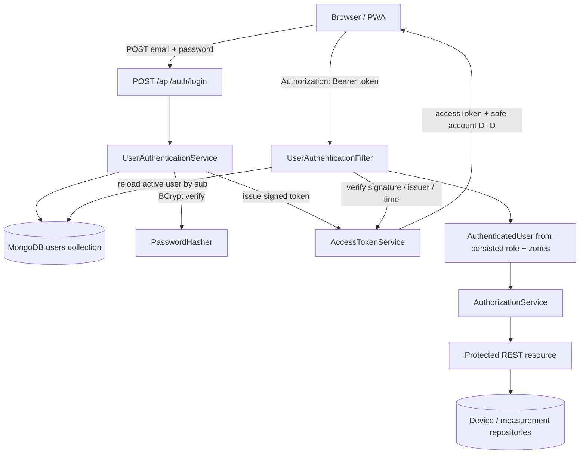
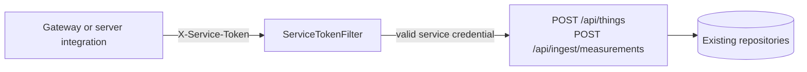

# SMART MUSEUM — TECHNICAL IMPLEMENTATION HANDOFF

## Backend Authentication & Authorization Foundation

**Project:** Smart Museum  
**Module:** Backend  
**Technology:** Java 21, Jakarta EE 11, WildFly 41/42, MongoDB, JWT  
**Implementation:** Human authentication and ADMIN/CLIENT authorization  
**Purpose:** Developer handoff  
**Document date:** 2026-11-08  
**Repository baseline:** `main` at `830ab29`; the authentication implementation reviewed here was present as uncommitted working-tree changes when this document was generated.

> **Verification boundary:** Maven tests and WAR packaging are verified from the local build reports. Deployment to WildFly, live MongoDB account lookup, and browser-to-backend login have not been verified.

## 1. Executive Summary

The earlier backend exposed device and measurement reads without a human identity or per-zone authorization. Device approval/rejection used a shared `X-Admin-Token`. That arrangement could not distinguish individual administrators or restrict CLIENT users to assigned zones, and a shared admin secret would be exposed if included in browser JavaScript.

The implementation adds backend-managed accounts in MongoDB, BCrypt password hashing, short-lived signed JWTs, a name-bound bearer-token authentication filter, role checks, and persisted CLIENT zone assignments. Admin-only device approval/rejection is now authorized by the authenticated account. The existing service-token path remains separate for server-to-server routes.

Protected resource methods and the authentication services compile and their unit tests pass. The implementation is **not yet runtime-verified** on the target WildFly/MongoDB setup. Neither PWA has been connected to login or bearer authentication.

## 2. Previous Architecture and Security Limitations

Before this foundation:

- `GET /api/devices`, device details, and measurement reads did not require authentication.
- `POST /api/devices/{deviceId}/approve` and `/reject` relied on `AdminTokenFilter`, which compared `X-Admin-Token` to the server-side `ADMIN_TOKEN` environment value.
- `POST /api/things` and `POST /api/ingest/measurements` already used a separate `X-Service-Token` through `ServiceTokenFilter`.
- There was no persisted human account, active/disabled account check, or persisted role/zone authorization for reads.

The shared service/admin values are bearer secrets: anyone who can read frontend JavaScript or its network requests can copy a value embedded in the browser bundle. The PWA must never contain `X-Service-Token`, `ADMIN_TOKEN`, or the JWT signing key. The admin shared-token filter and annotation have been removed. The service-token filter and its annotation remain.

## 3. Implemented Authentication Architecture

The browser login request reaches `AuthResource.login()`, which delegates to `UserAuthenticationService.login()`. The service looks up the normalized email in `UserRepository`, checks active status, and verifies the submitted password using `PasswordHasher`. On success, `AccessTokenService.issue()` returns a signed access token and a safe `UserAccount` DTO.

For protected resources, `UserAuthenticationFilter` validates the bearer token, then resolves the current active account by JWT subject. The role and zone assignments come from the persisted account. The filter installs an `AuthenticatedUser` as the request principal. Resource methods then enforce Admin role or zone access using `AuthorizationService`.



Machine-to-machine traffic remains independent:



The login endpoint is public; the account lookup and password hash stay on the backend. Protected human endpoints use `Authorization: Bearer …`. Service routes continue using `X-Service-Token` and do not accept a human JWT as a replacement.

## 4. User Account Model

`UserEntity` is stored in the MongoDB `users` collection. `emailKey` is the Mongo `_id` and is produced by trimming and lowercasing the email with `Locale.ROOT`; this makes duplicate normalized emails collide on Mongo’s unique `_id`. `userId` is a separate UUID and is the JWT subject.

Persisted fields are `emailKey`, `userId`, `name`, `email`, `passwordHash`, `role`, `status`, and `zoneIds`.

Illustrative record (fictional; hash is a placeholder):

```json
{
  "_id": "curator@example.test",
  "userId": "550e8400-e29b-41d4-a716-446655440000",
  "name": "Sample Curator",
  "email": "curator@example.test",
  "passwordHash": "$2a$12$<placeholder-bcrypt-hash>",
  "role": "CLIENT",
  "status": "active",
  "zoneIds": ["salle-01", "salle-03"]
}
```

Roles are `ADMIN` and `CLIENT`; account statuses used by authentication are `active` and `disabled`. Login rejects disabled users. An empty CLIENT zone list grants no zone access. `UserAccount` is the public response model and contains `userId`, `name`, `email`, `role`, `status`, and `zoneIds`. It does not expose `passwordHash` or the submitted password.

`UserData.findByUserId()` is the Jakarta Data derived query used to resolve JWT subjects; `findByEmail()` uses `findById()` on `emailKey`. Actual query generation against the target runtime is not verified in this document’s build-only checks.

## 5. Password Security

`PasswordHasher.hash()` calls jBCrypt `BCrypt.hashpw()` with a generated salt at fixed cost **12**. `UserAuthenticationService.provision()` is the account-creation path that hashes a password before persistence. Password verification uses `PasswordHasher.verify()`, which rejects malformed encodings and delegates valid hashes to `BCrypt.checkpw()`.

The cost is a constant in `PasswordHasher.COST`; it is not configurable by environment. Provisioned passwords must have Java `String.length()` of at least 12 and no more than 72 UTF-8 bytes, matching BCrypt’s input limit. Login validates a non-empty password but reports the same generic 401 for unknown email, wrong password, and disabled account. Passwords are transient request values; only the BCrypt string is persisted. No password/hash is logged by these auth classes or returned in `UserAccount`.

## 6. JWT Authentication

`AccessTokenService` uses JJWT 0.12.6 and calls `signWith(key)`. The documented key-generation command returns exactly 32 random bytes, which produces HS256. The code accepts keys of at least 32 bytes; with longer keys JJWT can select HS384/HS512 based on the resulting key algorithm. `JWT_SIGNING_KEY_BASE64` is decoded server-side. There is no hard-coded fallback key. Missing/invalid configuration makes token service initialization fail.

Issued claims are `iss`, `sub` (UUID user ID), `role`, `iat`, and `exp`. Email, password, password hash, and zone assignments are not JWT claims. `JWT_ISSUER` defaults to `smart-museum`; `JWT_ACCESS_TOKEN_SECONDS` defaults to 900 and accepts 60 through 3600 seconds.

Validation uses `verifyWith(key)`, `requireIssuer(issuer)`, and `parseSignedClaims()`. Additional checks require a non-empty subject, an issued-at and expiration time, `iat` no more than 30 seconds in the future, expiration after issue time, and a token lifetime no greater than one hour. The filter also accepts only `ADMIN` or `CLIENT` role claims and requires that the persisted current role matches the claim. Missing/malformed/expired/invalid bearer tokens and inactive or missing users return 401.

Protected calls send:

```http
Authorization: Bearer <access-token>
```

Logout is stateless and has no endpoint: the client discards its token. A copied token remains usable until expiration unless its account is disabled, removed, or has a changed role (the account is reloaded on each protected request). There is no refresh-token or revocation-list mechanism. Only one signing key is active; replacing it immediately invalidates existing tokens.

Fictional payload illustration (not a signed token):

```json
{
  "iss": "smart-museum",
  "sub": "550e8400-e29b-41d4-a716-446655440000",
  "role": "CLIENT",
  "iat": 1794144000,
  "exp": 1794144900
}
```

## 7. Authentication API

### `POST /api/auth/login`

`AuthResource` consumes and produces JSON. No authorization header is required. The request DTO is `LoginRequest`:

```json
{"email":"admin@example.test","password":"<ADMIN_PASSWORD>"}
```

Success is HTTP 200 with `LoginResponse`:

```json
{
  "accessToken":"<JWT>",
  "tokenType":"Bearer",
  "expiresIn":900,
  "user":{
    "userId":"550e8400-e29b-41d4-a716-446655440000",
    "name":"Sample Administrator",
    "email":"admin@example.test",
    "role":"ADMIN",
    "status":"active",
    "zoneIds":[]
  }
}
```

Invalid request fields return 400 `INVALID_SCHEMA`. Unknown email, incorrect password, or disabled account return 401 `UNAUTHORIZED` with a generic login message. `login()` does not itself whitelist the stored role before issuing a token; the protected-request filter accepts only `ADMIN`/`CLIENT` and requires the persisted role to match the token. Subsequent protected requests use the returned token in the Bearer header.

### `POST /api/users`

`UserResource.provisionClient()` requires a valid Admin JWT and creates **only** a Client account. Request fields are `name`, `email`, `password`, and `zoneIds`. Success is HTTP 201 with a safe `UserAccount` DTO. Invalid values return 400; duplicate normalized email returns 409 `INVALID_STATE`; missing/invalid token returns 401; a non-Admin returns 403 `FORBIDDEN`.

There is no general user-list/update/delete endpoint, no Admin account creation endpoint, and no account-disable endpoint. The initial Admin is provisioned by server configuration; additional Client accounts are created by an Admin.

## 8. Authorization Matrix

| Resource | ADMIN | CLIENT | Unauthenticated / invalid credential |
|---|---|---|---|
| `GET /api/health` | Public | Public | 200; response includes `status` and Mongo `UP`/`DOWN` |
| `GET /api/devices` | All devices | Filtered to persisted assigned zones | 401 |
| `GET /api/devices/{deviceId}` | Any existing device | Only if device zone is assigned | 401; missing device 404 |
| `GET /api/measurements/latest?zoneId=…` | Any zone | Assigned zone only | 401; missing `zoneId` 400 |
| `GET /api/measurements?...` | Any existing device | Only if device’s persisted zone is assigned | 401; missing device 404 |
| `POST /api/devices/{id}/approve` | Allowed by `DiscoveryService` state rules | 403 | 401 |
| `POST /api/devices/{id}/reject` | Allowed by current `DiscoveryService` behavior | 403 | 401 |
| `GET /api/things`, `GET /api/things/{id}` | Allowed | 403 | 401 |
| `POST /api/things` | Service token required | Service token required | 401 if token missing/invalid |
| `POST /api/ingest/measurements` | Service token required | Service token required | 401 if token missing/invalid |
| `POST /api/users` | Creates Client account | 403 | 401 |

HTTP 401 means the request has no acceptable authenticated identity (or login credentials are invalid). HTTP 403 means the identity is authenticated but does not have the required Admin role or zone permission. `ApiExceptionMapper` serializes API exceptions as `{ "error", "message" }` JSON. Service authentication errors use the same 401 `UNAUTHORIZED` code. Device trust errors remain separately represented as `DEVICE_NOT_TRUSTED` where existing ingestion validation uses them.

`DiscoveryService.approve()` requires a registered device and a stored Thing Description; missing device returns 404 and missing TD returns 409. It activates any non-active device with a stored Thing Description (the source comment names pending/offline/rejected) and is a no-op for an already active device. `reject()` sets any known device to rejected; no additional transition restriction is implemented.

## 9. CLIENT Zone Authorization

Zone IDs are persisted in the account’s `zoneIds`. The authentication filter reloads the account for every protected request and puts the stored assignments on `AuthenticatedUser`; authorization does not trust zone lists supplied by the client or copied into token claims.

- Device list results are filtered in `DeviceResource.list()` for CLIENT users.
- Device detail loads the device through `DeviceRepository.findById()` and checks its stored `zoneId`.
- Latest readings validate the requested `zoneId` against the principal before `MeasurementRepository.findLatest()`.
- History first resolves `deviceId` to its device record, then checks that device’s zone before querying history.
- Empty `zoneIds` does not match any zone; the device list is empty and zone-specific reads return 403.

Example: a CLIENT assigned `salle-01` can request latest readings for `salle-01` (allowed) but receives 403 `FORBIDDEN` for `salle-02`. A history query for a device in `salle-02` is also denied even when its `deviceId` is guessed. Admins bypass zone restrictions.

The Admin provision endpoint validates zone ID syntax and uniqueness, but it does not verify that every zone currently exists; the repository has no Zone entity/API in this implementation. That behavior should be revisited when Zone CRUD is designed.

## 10. ADMIN Account Provisioning

`BootstrapAdmin.onStart()` reads these server-side variables:

- `BOOTSTRAP_ADMIN_NAME`
- `BOOTSTRAP_ADMIN_EMAIL`
- `BOOTSTRAP_ADMIN_PASSWORD`

If all are blank, bootstrap is skipped. If only some are configured, application startup throws `IllegalStateException`. If the normalized email is absent, the code provisions an active ADMIN with no zone list. If it already belongs to an active ADMIN, bootstrap leaves it unchanged and does not reset its password. A collision with a non-Admin or disabled account fails startup.

Remove the bootstrap variables after provisioning and keep the password in a protected server-side secret store. The code does not generate a default production password. Admins provision Client accounts through `POST /api/users`; the endpoint does not permit creating another Admin.

JWT configuration names are `JWT_SIGNING_KEY_BASE64`, `JWT_ISSUER` (default `smart-museum`), and `JWT_ACCESS_TOKEN_SECONDS` (default 900; range 60–3600).

## 11. Service-to-Service Authentication

`ServiceTokenFilter` is bound to `@ServiceTokenRequired`. It reads `INGEST_SERVICE_TOKEN` from the process environment and compares it to `X-Service-Token` using `MessageDigest.isEqual`. If the expected token is absent/blank or the header does not match, it returns 401. Existing bindings remain on:

- `POST /api/ingest/measurements`
- `POST /api/things`

This is machine-to-machine authentication and must stay in the server/gateway integration environment, never in PWA JavaScript or Vite variables. Future MQTT integration must call these routes from a trusted server-side bridge that can hold the service token. The browser Admin actions no longer use `X-Admin-Token`; they use an Admin JWT.

## 12. CORS and Browser Security

`CorsFilter` reads comma-separated `CORS_ALLOWED_ORIGINS`. Its code default is `http://localhost:5173,http://localhost:5174`. For an allowed Origin it returns `Access-Control-Allow-Headers: Content-Type, Authorization`, methods `GET, POST, PUT, DELETE, OPTIONS`, exposes `Link, Location`, sets `Vary: Origin`, and caches preflight for 3600 seconds. It does not set `Access-Control-Allow-Credentials`; the implementation uses explicit Bearer headers, not cookie sessions. The `OPTIONS` request filter aborts with 200 when an Origin header is present; response headers are added only when the origin is in the configured set.

Use HTTPS outside localhost for passwords and bearer tokens. The repository does not implement TLS termination/deployment. Never place `JWT_SIGNING_KEY_BASE64`, `INGEST_SERVICE_TOKEN`, bootstrap passwords, or other server secrets in `VITE_*`: Vite values are included in frontend assets. The service token header is not among browser CORS allowed headers.

## 13. File-by-File Implementation Reference

| Group | File path | Responsibility / change |
|---|---|---|
| Authentication | `backend/src/main/java/tn/supcom/museum/rest/AuthResource.java` | Public `POST /auth/login` endpoint. |
| Authentication | `backend/src/main/java/tn/supcom/museum/security/UserAuthenticationService.java` | Login validation, password verification, account provisioning, active-user lookup. |
| JWT | `backend/src/main/java/tn/supcom/museum/security/AccessTokenService.java` | Key config, token issue/validation, claims and lifetime checks. |
| JWT | `backend/src/main/java/tn/supcom/museum/security/UserAuthenticated.java` | JAX-RS name binding for protected human endpoints. |
| JWT | `backend/src/main/java/tn/supcom/museum/security/UserAuthenticationFilter.java` | Bearer parsing, JWT/account validation, request principal installation, 401 response. |
| Passwords | `backend/src/main/java/tn/supcom/museum/security/PasswordHasher.java` | jBCrypt cost 12 hash and verify operations. |
| Authorization | `backend/src/main/java/tn/supcom/museum/security/AuthorizationService.java` | Admin-role and assigned-zone checks. |
| Accounts | `backend/src/main/java/tn/supcom/museum/entity/UserEntity.java` | `users` Mongo entity; normalized email key and account fields. |
| Accounts | `backend/src/main/java/tn/supcom/museum/data/UserData.java` | Jakarta Data repository for insert, ID and userId lookup. |
| Accounts | `backend/src/main/java/tn/supcom/museum/repository/UserRepository.java` | Email normalization and safe DTO mapping. |
| DTOs | `backend/src/main/java/tn/supcom/museum/model/LoginRequest.java` | Login request body. |
| DTOs | `backend/src/main/java/tn/supcom/museum/model/LoginResponse.java` | Token response record. |
| DTOs | `backend/src/main/java/tn/supcom/museum/model/UserAccount.java` | Public safe account view (no hash). |
| DTOs | `backend/src/main/java/tn/supcom/museum/model/ClientProvisionRequest.java` | Admin Client-provision request body. |
| DTOs | `backend/src/main/java/tn/supcom/museum/model/AuthenticatedUser.java` | Principal carrying persisted user ID, role and zones. |
| Provisioning | `backend/src/main/java/tn/supcom/museum/startup/BootstrapAdmin.java` | Optional server-configured initial Admin. |
| REST / authorization | `backend/src/main/java/tn/supcom/museum/rest/UserResource.java` | Admin-only Client account creation. |
| REST / authorization | `backend/src/main/java/tn/supcom/museum/rest/DeviceResource.java` | Authentication, Client list filtering/detail zone checks, Admin approval/rejection. |
| REST / authorization | `backend/src/main/java/tn/supcom/museum/rest/MeasurementResource.java` | Authentication and zone checks for latest/history reads. |
| REST / authorization | `backend/src/main/java/tn/supcom/museum/rest/ThingResource.java` | Admin-only TD reads; service-token announcement remains. |
| REST / errors | `backend/src/main/java/tn/supcom/museum/error/ApiException.java` | Adds `FORBIDDEN` authorization exception. |
| Config | `backend/src/main/java/tn/supcom/museum/config/CorsFilter.java` | Default local origins; permits Authorization; removes Admin/service headers from CORS allowlist. |
| Config | `backend/.env.example` | Documents server-side JWT and bootstrap configuration with empty secret placeholders. |
| Dependencies | `backend/pom.xml` | Adds JJWT 0.12.6 and jBCrypt 0.4. |
| API contract | `contracts/openapi.yaml` | Documents login, Client provisioning, bearer scheme, and protected operations. |
| Documentation | `backend/README.md` | Configuration, bootstrap, API usage, role/zone behavior, and limitations. |
| Tests | `backend/src/test/java/tn/supcom/museum/security/` | Token, password, service, role, and binding tests. |
| Tests | `backend/src/test/java/tn/supcom/museum/rest/` | Device and measurement zone authorization tests. |
| Removed | `backend/src/main/java/tn/supcom/museum/security/AdminTokenFilter.java` | Old shared Admin-token filter removed. |
| Removed | `backend/src/main/java/tn/supcom/museum/security/AdminTokenRequired.java` | Old name binding removed. |

`ServiceTokenFilter.java` and `ServiceTokenRequired.java` were not replaced; they remain the distinct server-to-server security mechanism.

## 14. Testing and Verification

The existing Surefire XML reports in `backend/target/surefire-reports/` were inspected. They total **40 tests, 0 failures, 0 errors, 0 skipped** across 12 suites, including the new password, JWT, auth service, authorization, binding, device, and measurement tests.

The reported command `mvn -B -f backend/pom.xml package` completed successfully; the WAR exists at `backend/target/smart-museum.war`. The OpenAPI file parsed as valid YAML and `git diff --check` passed at implementation verification. These results are build/test evidence, not runtime integration evidence.

Not tested: deployment to the target WildFly 41/42 instance; live MongoDB user insert/find behavior; Jakarta Data derived query generation for `findByUserId()` on that runtime; browser login; or either PWA using Bearer auth. The auth tests use isolated test objects/stubs and do not require production MongoDB or credentials.

## 15. Deployment and Configuration Guide

The checked-in backend README targets Windows PowerShell, Java 21, Docker Compose MongoDB, and `C:\wildfly-41.0.1.Final`. These are development instructions; paths and service state are environment dependent.

1. Start the development MongoDB service from repository root:

   ```powershell
   docker compose -f backend/docker-compose.dev.yml up -d
   ```

2. Generate a fresh JWT key. Do not copy the output into source control:

   ```powershell
   [Convert]::ToBase64String([Security.Cryptography.RandomNumberGenerator]::GetBytes(32))
   ```

3. In the same protected environment that will launch WildFly, configure `JWT_SIGNING_KEY_BASE64`, optional `JWT_ISSUER`, `JWT_ACCESS_TOKEN_SECONDS`, `CORS_ALLOWED_ORIGINS`, and required server-side `INGEST_SERVICE_TOKEN`. Configure `BOOTSTRAP_ADMIN_NAME`, `BOOTSTRAP_ADMIN_EMAIL`, and `BOOTSTRAP_ADMIN_PASSWORD` together only for first-run bootstrap. Supply passwords through a protected secret mechanism; do not put them in scripts or committed `.env` files.

4. Build and verify tests:

   ```powershell
   mvn -B -f backend/pom.xml package
   ```

5. Deploy the generated WAR using the repository’s documented WildFly path (adjust if installed elsewhere):

   ```powershell
   Copy-Item backend\target\smart-museum.war C:\wildfly-41.0.1.Final\standalone\deployments\
   & C:\wildfly-41.0.1.Final\bin\standalone.bat
   ```

   Environment variables must be available to the process before starting WildFly. The deployment itself has not been verified here.

6. Check health and confirm Mongo is actually up (HTTP health remains 200 when Mongo returns `DOWN`):

   ```powershell
   Invoke-RestMethod http://localhost:8080/api/health
   ```

7. Log in and call a protected Admin endpoint. Do not put a real password in a saved script:

   ```powershell
   $adminPassword = Read-Host 'Admin password'
   $body = @{ email = '<BOOTSTRAP_ADMIN_EMAIL>'; password = $adminPassword } | ConvertTo-Json
   $login = Invoke-RestMethod -Method Post -Uri http://localhost:8080/api/auth/login `
     -ContentType 'application/json' -Body $body
   $headers = @{ Authorization = "Bearer $($login.accessToken)" }
   Invoke-RestMethod -Uri http://localhost:8080/api/devices -Headers $headers
   ```

8. Use `POST /api/users` with an Admin bearer token to create a Client, then log in as that Client. Request an assigned zone and an unassigned zone to confirm 200/403 behavior. Use non-production test accounts and secrets.

Outside localhost, place the API behind HTTPS. TLS termination is not provided by the repository’s backend configuration and must be supplied by the deployment environment.

## 16. Example API Requests

All values below are fictional placeholders. Shell variables must be supplied securely.

**Admin login:**

```http
POST /api/auth/login
Content-Type: application/json

{"email":"<ADMIN_EMAIL>","password":"<ADMIN_PASSWORD>"}
```

**Client login:**

```http
POST /api/auth/login
Content-Type: application/json

{"email":"<CLIENT_EMAIL>","password":"<CLIENT_PASSWORD>"}
```

**Authenticated device list:**

```http
GET /api/devices
Authorization: Bearer <ADMIN_OR_CLIENT_JWT>
```

**Latest readings for a zone:**

```http
GET /api/measurements/latest?zoneId=salle-01
Authorization: Bearer <JWT_WITH_ACCESS_TO_salle-01>
```

**Denied Client zone example:** a Client assigned only `salle-01` requests `GET /api/measurements/latest?zoneId=salle-02`; expected result is `403` with `{"error":"FORBIDDEN","message":"Access to this zone is not permitted"}`.

**Admin approval:**

```http
POST /api/devices/<PENDING_DEVICE_ID>/approve
Authorization: Bearer <ADMIN_JWT>
```

The endpoint has no request body. A registered Thing Description is required by `DiscoveryService.approve()`.

**Client provisioning by Admin:**

```http
POST /api/users
Authorization: Bearer <ADMIN_JWT>
Content-Type: application/json

{"name":"Sample Curator","email":"<CLIENT_EMAIL>","password":"<TEMPORARY_CLIENT_PASSWORD>","zoneIds":["salle-01"]}
```

**Server-side measurement ingestion:**

```http
POST /api/ingest/measurements
X-Service-Token: <SERVER_SIDE_INGEST_SERVICE_TOKEN>
Content-Type: application/json

{"measurementId":"<UUID>","deviceId":"bme280-01","zoneId":"salle-01","property":"temperature","value":19.8,"unit":"°C","observedAt":"<ISO-8601-UTC>","source":"real","gatewayId":"gw-01","quality":"good"}
```

The ingestion route still requires its existing service token and measurement validation (including `source`, active device state, ranges, and Thing Description affordances). The PWA authentication token does not replace it.

## 17. Known Limitations and Future Work

- Logout is client-side token discard only; no refresh tokens or token revocation store exist.
- One signing key is accepted; rotation invalidates current tokens.
- There is no full user CRUD, Client disable API, Admin creation API, password recovery, email verification, invitation workflow, or brute-force throttling.
- Client zone IDs are syntax-validated but not checked against a persisted Zone resource; Zone CRUD is absent.
- Account status and role are re-read on each protected request. Zone assignment is also loaded from storage per request, not trusted from the JWT.
- WildFly/Mongo runtime behavior and the derived Jakarta Data lookup remain to be verified.
- Client and Admin PWAs are not yet integrated with login, token handling, or protected routes.
- No browser-level end-to-end tests have been completed.
- Zone CRUD, Threshold CRUD, alerts, AI, MQTT bridging, and deployment redesign are outside this authentication handoff.

## 18. Handoff: What the Next Developer Should Do

**Step 1 — Verify deployment.** Start MongoDB and the target WildFly version with test-only secrets; verify bootstrap, login, JWT rejection cases, `findByUserId()`, and role/zone authorization against the actual runtime.

**Step 2 — Integrate Client PWA.** Add login/session handling and Bearer headers in its service boundary; connect device/zone reads, latest readings and history; show 401/403 states; retain demo mode. Never put server secrets in Vite configuration.

**Step 3 — Integrate Admin PWA.** Add login/session handling; use authenticated device inventory and pending queue; call real approve/reject operations; handle action errors and refresh persisted state. Remove simulated approval only after backend integration is verified.

**Step 4 — Verify both PWAs.** Run browser-level workflows against the deployed backend, including Admin and Client roles, allowed/denied zones, approval/rejection, session expiry, and offline/error states. Preserve the existing UI designs.

## 19. Handoff Checklist

- [ ] Backend deployed on target WildFly with MongoDB connectivity verified.
- [ ] JWT key and issuer configured server-side.
- [ ] Initial ADMIN provisioned; bootstrap secrets removed.
- [ ] Login returns a valid short-lived token; malformed/expired tokens are rejected.
- [ ] ADMIN device inventory, approval, rejection, and TD access verified.
- [ ] CLIENT device and measurement access works only for assigned zones.
- [ ] Empty zone assignment grants no access.
- [ ] Service-token announcement and ingestion routes still work independently.
- [ ] Client PWA login and API integration completed; demo mode preserved.
- [ ] Admin PWA login and real approval flow completed; UI design preserved.
- [ ] Browser-level end-to-end and security tests passed.
