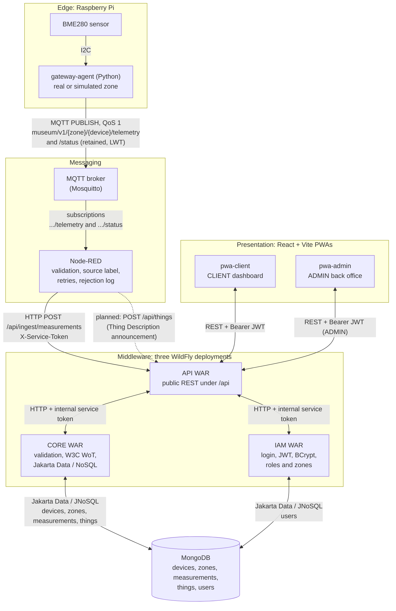
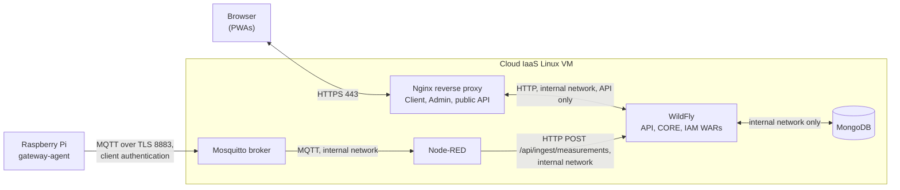

# Smart Museum: IoT Monitoring of Cultural Heritage Conditions

## 1. Project Overview

**Smart Museum** is an Internet of Things (IoT) and web platform that helps museums preserve artifacts by monitoring the environmental conditions of their exhibition rooms.

Temperature, relative humidity and atmospheric pressure are measured in each zone by a BME280 sensor connected to a Raspberry Pi gateway. Measurements travel through MQTT and Node-RED to a Jakarta EE **middleware**, which validates them, stores them in MongoDB and exposes them through a secured REST API. Two Progressive Web Applications (PWAs) present the data: a client dashboard for museum staff and an administration back office.

**Team 4:** Sirine Ben Yahia, Sourour Jaouadi, Yesmine Haddar.

### Main objectives

- Collect environmental measurements in several museum zones.
- Transport them reliably from the sensors to the middleware.
- Validate and store every measurement with its device, zone, source (real or simulated) and quality.
- Describe each device with a W3C Web of Things (WoT) Thing Description and require an administrator to approve new devices.
- Restrict access by role (`ADMIN`, `CLIENT`) and by zone.
- Display current and historical measurements in installable, offline-capable PWAs.

---

## 2. System Architecture

The system is organised in four layers:

1. **Edge (IoT) layer:** a BME280 sensor is read over I2C by the `gateway-agent` running on a Raspberry Pi. A second zone can be simulated by the same agent.
2. **Messaging layer:** the gateway publishes measurements to an MQTT broker (Mosquitto). Node-RED subscribes to the telemetry topics, validates each message, labels it as `real` or `simulated`, and forwards it to the middleware over HTTP.
3. **Middleware layer:** three independently deployable Jakarta EE 11 WAR applications on WildFly: **API** (public REST endpoints), **IAM** (identity and access management) and **CORE** (museum business logic, W3C WoT and persistence with Jakarta Data / Jakarta NoSQL). API communicates with IAM and CORE over authenticated internal HTTP. A shared **Contracts** JAR carries the request and response types.
4. **Presentation layer:** two React + Vite PWAs, `pwa-client` (CLIENT dashboard) and `pwa-admin` (ADMIN back office), both connected to the API.

### Technical architecture (current implementation)



**Reading the diagram**

| Notation | Meaning |
|---|---|
| Solid arrow `A → B` | Data flows from A to B; A initiates the exchange. Implemented in this repository. |
| Double arrow `A ↔ B` | Request/response: A sends the request, B returns the response. |
| Dashed arrow | Supported by the receiving side but not yet connected (see section 10). |
| Box inside *Middleware* | An independently deployable WAR. API-to-service calls use internal HTTP and a shared service token. |

Notes on the diagram:

- The gateway publishes the device status on `.../status` (retained message, with an MQTT Last Will "offline"). Node-RED subscribes to it and displays it in its debug panel; the middleware does not consume it yet.
- The PWAs never access MongoDB, the broker or the ingestion endpoint directly. They only call the REST API with a short-lived JWT.
- The `X-Service-Token` used by Node-RED is a server-side secret; it is never placed in browser code.

### Path of a measurement

1. The `gateway-agent` reads the BME280 over I2C and builds one measurement per property (`temperature`, `humidity`, `pressure`), each with a UUID `measurementId` and a UTC `observedAt`.
2. It publishes each measurement with MQTT QoS 1 on `museum/v1/{zoneId}/{deviceId}/telemetry`. If the network is down, messages are queued (up to 5,000) and resent.
3. Node-RED, subscribed to `museum/v1/+/+/telemetry`, checks the message (valid JSON, required fields, UUID, identifiers, known property, finite numeric value, unit, ISO UTC date, consistency between the topic and `zoneId`/`deviceId`). It sets `source` to `simulated` when `deviceId` starts with `sim-` or `gatewayId` starts with `gw-sim`, and to `real` otherwise; the sender never chooses. Invalid messages are written to a rejection log and never stop the flow.
4. Node-RED sends the measurement to `POST /api/ingest/measurements` with the `X-Service-Token` header. On a `5xx` response or a network error it retries with the same `measurementId` and an increasing delay (2 s to 60 s, 30 attempts by default), which is safe because ingestion is idempotent.
5. API authenticates the ingest service token, then calls CORE over authenticated internal HTTP. CORE runs the six-step validation chain (section 4.3).
6. The measurement is stored in MongoDB through a Jakarta Data repository. A repeated `measurementId` is ignored (HTTP 200); a new one is accepted (HTTP 202).
7. A user signs in through `POST /api/auth/login`. API asks IAM to validate the credentials and issue a JWT. For each protected request, API asks IAM to validate the token and the current account state, then calls CORE for the authorised device, zone and measurement data.

### Production cloud target (not yet implemented)

The architecture document defines the following production cloud target. Local WildFly HTTPS for development is implemented, but the production Nginx, certificate and broker configuration is not present in this repository.



Only ports 443 (HTTPS) and 8883 (MQTT over TLS) are exposed; MongoDB and the broker administration stay on the internal network.

---

## 3. Technologies and Tools

| Component | Technology | Purpose |
|---|---|---|
| IoT hardware | Raspberry Pi, BME280 (I2C, 3.3 V) | Measure temperature, humidity and pressure |
| Gateway software | Python 3, `paho-mqtt` 2, `RPi.bme280`, systemd | Read the sensor, publish measurements, restart on failure |
| Messaging | MQTT (QoS 1), Mosquitto | Transport measurements and device status |
| Flow integration | Node-RED (`node-red/flows.json`) | Validate messages, label the source, forward measurements, retry, log rejections |
| Middleware | Java 21, Jakarta EE 11 (REST, CDI, JSON-B) | Validation, business logic and REST API |
| Persistence | Jakarta Data 1.0 and Jakarta NoSQL (Eclipse JNoSQL 1.1) | Entities and repositories on MongoDB |
| Device description | W3C WoT Thing Description 1.1 (JSON-LD) | Describe device properties, events and access forms |
| Identity and access | JWT (JJWT 0.12), BCrypt (jBCrypt) | Sign-in, signed tokens, `ADMIN`/`CLIENT` roles and zones |
| Application server | WildFly 42 | Run the middleware and host the PWAs locally |
| Build | Apache Maven | Dependencies, tests and WAR packaging |
| Database | MongoDB 7 (Docker) | Store devices, zones, measurements, Thing Descriptions and accounts |
| Frontend | React 19, Vite 7, Vitest, Node.js test runner | Client and admin PWAs |
| Local HTTPS | mkcert, OpenSSL (PKCS#12 keystore) | Locally trusted development certificate |
| API contract | OpenAPI 3 (`contracts/openapi.yaml`), Postman | Document and test the API |
| CI | GitHub Actions (`middleware-ci`) | Build and test the middleware on every push or pull request that changes it |

---

## 4. Main System Components

### 4.1 Edge layer: `gateway-agent`

Python agent running on the Raspberry Pi as a systemd service.

- Reads the BME280 over I2C and publishes one MQTT message per property.
- Real device: `bme280-01`, zone `salle-01`, gateway `gw-01`.
- Simulated second zone: `sim-bme280-02`, zone `salle-02`, gateway `gw-sim`. A simulated sensor must use a `sim-`/`gw-sim` identifier, so a simulated value can never be presented as real.
- Publishes its status on `.../status`: `online` at connection, `offline` with reason `lwt` (published by the broker) or `shutdown`.
- Reconnects automatically and queues up to 5,000 messages during network outages.
- Contains no secret: MQTT credentials are read from environment variables (`MQTT_USERNAME`, `MQTT_PASSWORD`).

Details: [`gateway-agent/README.md`](gateway-agent/README.md).

### 4.2 Messaging layer: MQTT and Node-RED

| Topic | QoS | Content |
|---|---|---|
| `museum/v1/{zoneId}/{deviceId}/telemetry` | 1 | One measurement (JSON) |
| `museum/v1/{zoneId}/{deviceId}/status` | 1, retained | `online` / `offline` |
| `museum/v1/{zoneId}/{deviceId}/td` | 1 | Planned: Thing Description announcement of a new device |

The Node-RED flow is versioned in [`node-red/flows.json`](node-red/flows.json) (one tab, "Smart Museum - ingestion (P1)"):

| Middleware response | Node-RED action |
|---|---|
| `202` accepted, `200` duplicate | Success |
| `400`, `403`, `422` | Permanent rejection: written to the log, never retried |
| `401` | Configuration alert (service token refused) and log entry |
| `5xx` or no response | New attempt with the same `measurementId` |

- **Rejection log:** one JSON line per rejected message in `REJECTED_LOG_FILE` (default `/data/logs/rejected.jsonl`).
- **Environment variables:** `MQTT_HOST`, `MQTT_PORT`, `BACKEND_URL`, `INGEST_SERVICE_TOKEN`, `INGEST_MAX_ATTEMPTS` (30 by default), `REJECTED_LOG_FILE`. The flow file contains no secret.
- **Manual tests:** the `TEST mesure valide` and `TEST JSON casse` buttons only use the simulated device `sim-bme280-02`, never the real sensor.

Details: [`node-red/README.md`](node-red/README.md).

### 4.3 Middleware layer: Jakarta EE (`middleware/`)

`middleware/` is a Maven parent project that builds a shared Contracts JAR and three separately deployed WildFly WARs. The public API artifact is `smart-museum.war`.

| Module | Artifact | Responsibility | Main packages |
|---|---|---|---|
| `contracts` | `smart-museum-contracts` (JAR) | Shared serialised DTOs, error format, internal-service binding | `tn.supcom.museum.contracts`, shared model packages |
| `api` | `smart-museum.war` (`/api`) | Public REST resources, CORS, error mapping, authentication bridge, HTTP clients to CORE and IAM | `api.rest`, `api.config`, `api.error`, `api.service` |
| `iam` | `smart-museum-iam.war` (`/iam`) | Sign-in, user accounts, BCrypt, JWT issue and validation, account state, role and zone authorisation | `iam.security`, `iam.rest`, `iam.entity`, `iam.data`, `iam.repository` |
| `core` | `smart-museum-core.war` (`/core`) | Measurement validation, W3C WoT, discovery, geolocation, Jakarta NoSQL entities and Jakarta Data repositories | `core.validation`, `core.wot`, `core.geo`, `core.entity`, `core.data`, `core.repository` |

The services do not share CDI beans. API calls IAM and CORE over HTTP with the `X-Internal-Service-Token` header; the Contracts JAR is packaged into each application. CORE owns the `devices`, `zones`, `measurements` and `things` collections; IAM owns `users`; API has no MongoDB collection.

**Measurement validation chain** (`core.validation`, Chain of Responsibility pattern):

| Step | Check | Rejection |
|---|---|---|
| 1. Schema | JSON structure, identifiers, UUID, ISO 8601 UTC date, known property, `source` (`real`/`simulated`), `quality` | 400 |
| 2. Device identity | Device exists and belongs to the announced zone | 403 |
| 3. Range | Value within physical limits, quality not `bad`, `observedAt` not in the future | 422 |
| 4. Trust | Device is `active` (approved by an ADMIN) | 403 |
| 5. Affordance | Property and unit declared in the device's Thing Description | 422 |
| 6. Persistence | Stored; duplicate `measurementId` detected | 200 (duplicate) / 202 (accepted) |

Accepted physical ranges: temperature −40 to 85 °C, humidity 0 to 100 %, pressure 300 to 1,100 hPa, illuminance 0 to 100,000 lx (illuminance is supported by the middleware but not measured by the BME280).

**Device discovery** (`core.wot`): a new device is registered as `pending` with its Thing Description, then approved (`active`) or rejected by an ADMIN. Only `active` devices can send measurements.

**Geolocation** (`core.geo`): each zone has WGS84 coordinates and a floor. A device inherits its zone's location unless an ADMIN assigns it its own position; its `zoneId` never changes. In DEV, CORE seeds two sample zones with fictitious coordinates in central Tunis and the two test devices (disable with `SEED_DEVICES=false`).

Details: [`middleware/README.md`](middleware/README.md) and the [M2 implementation handoff](DOCS/M2_IMPLEMENTATION_HANDOFF.md).

### 4.4 Database layer: MongoDB

| Collection | Owner | Content |
|---|---|---|
| `devices` | CORE | Device identifier, type, zone, gateway, status (`pending`, `active`, `rejected`, `offline`), link to its Thing Description, last activity, optional own WGS84 location |
| `zones` | CORE | Zone identifier, name, WGS84 latitude/longitude and floor |
| `measurements` | CORE | One document per measurement: device, zone, gateway, property, value, unit, `observedAt`, `receivedAt`, source, quality |
| `things` | CORE | W3C WoT Thing Description of each device (JSON-LD) and its declared properties and units |
| `users` | IAM | Accounts: name, email, BCrypt hash, role (`ADMIN` / `CLIENT`), status, authorised zones |

### 4.5 Presentation layer: PWAs

Both PWAs are independent React + Vite applications with their own manifest, service worker and offline page. Each one supports two data modes selected at build time with `VITE_DATA_MODE`: `mock` (demonstration data, default for the development server and tests) and `api` (real middleware, used by the WildFly build).

**`pwa-client`** (front office, CLIENT role)

- Sign-in with email and password; the JWT is sent as `Authorization: Bearer` on each request.
- Conservation dashboard by zone: device information, zone and device location, latest measurements, real/simulated source and freshness indicator, with periodic refresh (15 s by default).
- Historical measurements with filters, an SVG chart and an accessible table.
- Loading, empty, error and offline states; installable PWA with a service worker.
- The alerts panel is a placeholder: no alert data is requested or computed.

**`pwa-admin`** (back office, ADMIN role)

- ADMIN sign-in; a CLIENT or disabled account is refused.
- Overview, device inventory with search and filters, pending devices with approval and rejection.
- Zone management (name and WGS84 location) and device location (own position or inherited from the zone).
- Creation of CLIENT accounts with their authorised zones.
- Not connected yet: the user list and the threshold page (no middleware endpoint exists; the thresholds shown are illustrative).

Details: [`DOCS/pwa-client.md`](DOCS/pwa-client.md) and [`DOCS/ADMIN_PWA.md`](DOCS/ADMIN_PWA.md).

---

## 5. Repository Structure

```text
SMART-MUSEUM/
|-- gateway-agent/              Raspberry Pi Python sensor agent, systemd service, tests
|-- node-red/                   Node-RED ingestion flow (flows.json)
|-- middleware/
|   |-- pom.xml                 Maven parent aggregator
|   |-- contracts/              shared DTO/error JAR
|   |-- core/                   CORE service WAR
|   |-- iam/                    IAM service WAR
|   |-- api/                    public API WAR (smart-museum.war)
|   |-- config/                 non-secret DEV/PROD configuration templates
|   `-- docker-compose.m2-sandbox.yml   isolated DEV MongoDB
|-- pwa-client/                 CLIENT React/Vite app and its static WAR (deployment/)
|-- pwa-admin/                  ADMIN React/Vite app and its static WAR (deployment/)
|-- deployment/                 WildFly build, HTTPS, deployment, rollback and acceptance scripts
|-- contracts/openapi.yaml      public API contract
|-- postman/                    Postman collection
|-- DOCS/                       architecture, handoffs, diagrams and reports
|-- .github/workflows/          middleware CI
|-- ATTRIBUTION.md              team and AI-assistance declaration
`-- report.md                   project report
```

### Team responsibilities

| Work package | Scope |
|---|---|
| P1: IoT | Sensor, `gateway-agent`, MQTT, Node-RED |
| P2: Middleware | Jakarta EE middleware (`api`, `iam`, `core`), MongoDB persistence, API contract |
| P3: Frontend | `pwa-client` and `pwa-admin` |

---

## 6. Middleware REST API

Base path: `/api`. Full contract: [`contracts/openapi.yaml`](contracts/openapi.yaml).

| Method | Endpoint | Authentication | Description |
|---|---|---|---|
| GET | `/api/health` | none | Middleware and MongoDB status |
| POST | `/api/auth/login` | none | Sign in; returns a JWT and the account |
| POST | `/api/users` | Bearer, ADMIN | Create a CLIENT account with its zones (201) |
| GET | `/api/devices?status=` | Bearer | Devices (CLIENT: only its zones) |
| GET | `/api/devices/{deviceId}` | Bearer | Device detail, with a `Link` header (`rel="describedby"`) to its Thing Description |
| POST | `/api/devices/{deviceId}/approve` | Bearer, ADMIN | Approve a device (`pending` → `active`) |
| POST | `/api/devices/{deviceId}/reject` | Bearer, ADMIN | Reject a device |
| PUT / DELETE | `/api/devices/{deviceId}/location` | Bearer, ADMIN | Set or clear an approved device's own WGS84 location (its `zoneId` never changes) |
| GET | `/api/zones`, `/api/zones/{zoneId}` | Bearer | Zones and their WGS84 coordinates (CLIENT: only its zones) |
| PUT | `/api/zones/{zoneId}` | Bearer, ADMIN | Create or update a zone's name and coordinates |
| GET | `/api/measurements/latest?zoneId=` | Bearer | Latest measurement per device and property in a zone |
| GET | `/api/measurements?deviceId=&property=&from=&to=&limit=` | Bearer | Measurement history (`limit` 1,000 by default, 5,000 maximum) |
| GET | `/api/things`, `/api/things/{deviceId}` | Bearer, ADMIN | W3C WoT Thing Descriptions (`application/td+json`) |
| POST | `/api/things` | `X-Service-Token` | Thing Description announcement (discovery) |
| POST | `/api/ingest/measurements` | `X-Service-Token` | Measurement ingestion (Node-RED) |

**Response codes:** `401` = missing or invalid credentials; `403` = authenticated but not allowed (role or zone); `409` = conflict with the current state (for example approving a device without a Thing Description, or an email that already exists). Errors are returned as `{"error": "...", "message": "..."}`.

### Examples

```http
GET https://api.smartmuseum.test/api/health
```

```json
{ "status": "UP", "mongo": "UP" }
```

```http
POST https://api.smartmuseum.test/api/auth/login
Content-Type: application/json

{ "email": "<ACCOUNT_EMAIL>", "password": "<ACCOUNT_PASSWORD>" }
```

```json
{ "accessToken": "<JWT>", "tokenType": "Bearer", "expiresIn": 900,
  "user": { "userId": "...", "name": "...", "email": "...", "role": "CLIENT", "status": "active", "zoneIds": ["salle-01"] } }
```

```http
GET https://api.smartmuseum.test/api/measurements/latest?zoneId=salle-01
Authorization: Bearer <JWT>
```

---

## 7. Installation and Local Development

The complete Windows guide is in [`deployment/README.md`](deployment/README.md) and the [M2 implementation handoff](DOCS/M2_IMPLEMENTATION_HANDOFF.md). The commands below are run from the repository root in Windows PowerShell.

### Prerequisites

- Git, Docker Desktop with Compose, Node.js and npm (20.19+ or 22.12+), Java 21 and Maven.
- WildFly 42.
- mkcert and OpenSSL for the local development certificate.
- Windows PowerShell for the deployment scripts.

### Local topology

| Deployment | WAR | Address |
|---|---|---|
| Client PWA | `smart-museum-client.war` | `https://smartmuseum.test/` |
| Admin PWA | `smart-museum-admin.war` | `https://admin.smartmuseum.test/` |
| Public API | `smart-museum.war` | `https://api.smartmuseum.test/api` |
| CORE | `smart-museum-core.war` | `http://localhost:8080/core` (internal, loopback only) |
| IAM | `smart-museum-iam.war` | `http://localhost:8080/iam` (internal, loopback only) |

Each PWA is a static WAR on its own Undertow virtual host. WildFly listens on the standard ports: HTTPS 443 and HTTP 80, which only redirects to HTTPS without a port number. CORE and IAM run on a separate internal Undertow server bound to `127.0.0.1:8080`; the WildFly management interface stays on `127.0.0.1:9990`.

### 1. Isolated DEV database

```powershell
docker compose -f middleware/docker-compose.m2-sandbox.yml up -d
docker exec museum-m2-sandbox-mongo mongosh --quiet --eval "db.adminCommand({ping:1}).ok"
```

The sandbox database `museum_m2_sandbox` listens on `127.0.0.1:27018`.

### 2. Secrets, certificate and WildFly configuration

If `middleware/config/dev.env` does not exist, initialise it once. The script generates random service tokens and a JWT key, and prompts securely for your own sandbox ADMIN account; never pass passwords on the command line. No account, password, token or key is shared through Git.

```powershell
.\deployment\initialize-dev-environment.ps1 -CreateBootstrapAdmin -WriteAcceptanceCredentials
.\deployment\prepare-local-https.ps1
$wildflyHome = 'C:\path\to\wildfly-42.0.0.Final'
.\deployment\configure-wildfly-https.ps1 -WildFlyHome $wildflyHome
.\deployment\configure-wildfly-ports.ps1 -WildFlyHome $wildflyHome   # WildFly stopped
```

Add the three local aliases to the Windows hosts file (elevated editor; the scripts never edit it):

```text
127.0.0.1 smartmuseum.test
127.0.0.1 admin.smartmuseum.test
127.0.0.1 api.smartmuseum.test
```

### 3. Build, start and deploy

```powershell
.\deployment\build-all.ps1                                          # tests + five WARs
.\deployment\start-wildfly.ps1 -Profile dev -WildFlyHome $wildflyHome   # dedicated window
.\deployment\configure-wildfly-hosts.ps1 -WildFlyHome $wildflyHome      # after WildFly has started
```

Then deploy with the documented wrappers (`deploy-all.ps1`, or `deploy-middleware.ps1`, `deploy-client.ps1` and `deploy-admin.ps1`). Replacing the API WAR requires a verified backup and its SHA-256 hash; `rollback-api.ps1` restores it. Never copy a WAR over a live deployment and never use the original `museum` database for these tests.

### 4. Health checks

- API: `https://api.smartmuseum.test/api/health`
- CORE: `http://localhost:8080/core/health`
- IAM: `http://localhost:8080/iam/health`

Use the locally trusted certificate in a normal browser. Do not disable TLS validation: with curl, use OpenSSL and `%LOCALAPPDATA%\mkcert\rootCA.pem` as described in the deployment guide.

### Optional PWA development servers

```powershell
Push-Location pwa-client
npm ci
npm test
npm run dev
Pop-Location
```

The development server uses mock mode by default. Set `VITE_DATA_MODE=api` only when testing against a running backend; the middleware `CORS_ALLOWED_ORIGINS` list must contain the exact Vite origin (`http://localhost:5173` in DEV). `VITE_*` variables are public and must never contain server secrets. The Admin app is started the same way from `pwa-admin`.

### Gateway and Node-RED

- Raspberry Pi installation, wiring and systemd service: [`gateway-agent/README.md`](gateway-agent/README.md).
- Node-RED: import `node-red/flows.json` into a Node-RED instance and provide the environment variables listed in section 4.2. The Compose file for Mosquitto and Node-RED is not versioned in this repository.

---

## 8. Testing and Validation

| Component | Command | Tests in the repository |
|---|---|---|
| Middleware | `mvn -f middleware/pom.xml clean verify` | 67 JUnit 5 tests (CORE 48, IAM 9, API 10) |
| Client PWA | `cd pwa-client && npm test` | 46 Node.js tests + 12 Vitest component tests |
| Admin PWA | `cd pwa-admin && npm test` | 16 Node.js tests + 43 Vitest component tests |
| Gateway agent | `cd gateway-agent && python3 -m pytest -q` | 25 pytest tests; no Raspberry Pi or broker needed |
| Full build | `.\deployment\build-all.ps1` | Runs the PWA and middleware tests, then packages the five WARs |
| Runtime integration | `.\deployment\test-m2-runtime.ps1 -ConfirmSandboxWrites` | Authentication, roles and zones, CORS, service tokens, Things, measurements, health and deployments |

The middleware tests also run in GitHub Actions on every push or pull request that changes `middleware/`.

The runtime acceptance script creates users, Things and measurements in `museum_m2_sandbox` and leaves the test records there. It refuses to run if DEV is not configured for `localhost:27018/museum_m2_sandbox`. Inspect the sandbox with:

```powershell
docker exec -it museum-m2-sandbox-mongo mongosh museum_m2_sandbox
```

A healthy middleware does not prove that the physical IoT chain works: the gateway, the MQTT broker and the Node-RED flow must also be running and configured.

---

## 9. Security

- **Two separate authentication paths:** people use a short-lived JWT (`Authorization: Bearer`, 15 minutes by default) obtained from `/api/auth/login`; Node-RED uses the `X-Service-Token` secret. A user token is not accepted on ingestion routes, and the service token is never sent to browsers.
- **Internal calls:** API calls CORE and IAM with a separate `X-Internal-Service-Token`; CORE and IAM are only reachable on the loopback interface.
- **Passwords** are stored only as BCrypt hashes (cost 12). Login takes the same time whether or not the email exists, so it does not reveal which emails have an account.
- **Authorisation is enforced by the middleware** on each endpoint: ADMIN-only operations, and CLIENT access limited to the zones stored in the account (not to zones claimed by the token or the browser).
- **Device trust:** only devices approved by an ADMIN (`active`) can send measurements, and only for the properties and units declared in their Thing Description.
- **Secrets** (`INGEST_SERVICE_TOKEN`, `INTER_SERVICE_TOKEN`, `JWT_SIGNING_KEY_BASE64`, bootstrap administrator password, keystore password) are environment variables, kept out of Git and never logged.
- **CORS** is limited to the configured PWA origins.
- **Local HTTPS:** WildFly uses the standard ports (HTTPS 443, HTTP 80 redirecting to HTTPS) with a mkcert certificate trusted for the current Windows user. Production still requires managed HTTPS, MQTT over TLS (8883), private MongoDB access and production secrets.

---

## 10. Current Development Status

### Implemented

- Gateway agent: BME280 reading, MQTT QoS 1 publishing, status and LWT, reconnection, simulated second zone, systemd service, unit tests.
- Node-RED flow: message validation, `source` labelling, forwarding with the service token, retries with idempotency, rejection log, status subscription.
- Middleware deployed as separate `smart-museum-core.war`, `smart-museum-iam.war` and `smart-museum.war` applications, with API-to-service HTTP protected by an internal service token.
- Measurement ingestion with the six-step validation chain and idempotency.
- Persistence with Jakarta NoSQL entities and Jakarta Data repositories on MongoDB.
- W3C WoT Thing Descriptions, device discovery with ADMIN approval, RFC 8288 `Link` header to the Thing Description.
- Accounts, BCrypt, JWT sign-in, ADMIN/CLIENT roles and zone-based authorisation.
- Geolocation: WGS84 zone coordinates and device location (own or inherited from the zone).
- Client PWA connected to the middleware (sign-in, zones, devices, latest and historical measurements), with mock mode, offline states and PWA installation.
- Admin PWA connected to the middleware (ADMIN sign-in, device inventory, approval and rejection, zones, device locations, CLIENT account creation).
- Local WildFly deployment over HTTPS on the standard ports, with build, deployment, rollback and acceptance scripts.
- Middleware CI on GitHub Actions.

### Not yet connected

- The gateway does not yet publish Thing Description announcements on `.../td`, and Node-RED does not relay them; the middleware endpoint `POST /api/things` is ready.
- The device status published on MQTT is not yet consumed by the middleware.
- The Admin PWA user list and threshold management have no middleware endpoint yet.
- Alerts are not implemented (placeholder panel in the client PWA).
- Production cloud deployment (Nginx, production certificates, MQTT over TLS) remains planned.

---

## 11. Future Improvements

- Publish Thing Descriptions from the gateway and relay them through Node-RED.
- Add user-list and threshold endpoints and connect the corresponding Admin pages.
- Alerts and notifications to museum staff when a threshold is exceeded.
- Real-time updates to the PWAs (WebSocket).
- AI-assisted analysis of measurements (planned in sprint S5).
- Cloud deployment behind Nginx with HTTPS and MQTT over TLS.

These items are planned and are not implemented functionality.

---

## 12. Conclusion

Smart Museum connects environmental sensors, an MQTT messaging chain, a Jakarta EE middleware and two PWAs to monitor and protect museum collections. Its layered architecture separates data collection, messaging, middleware processing (`api`, `iam`, `core`), persistence and presentation, so that each part can be developed, tested and secured independently.
