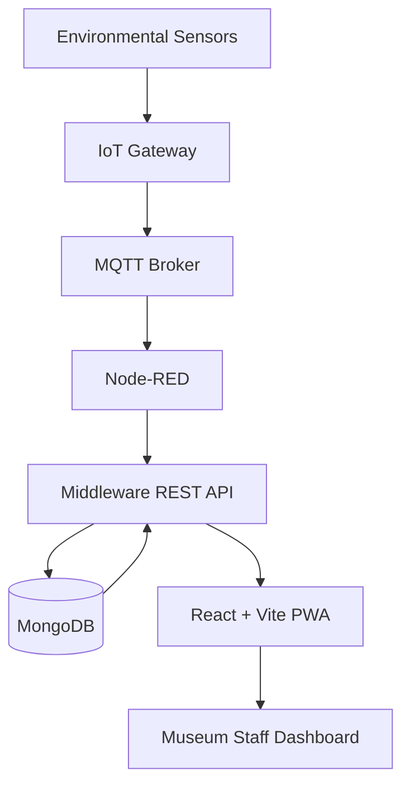

"# SMART-MUSEUM" 
# Smart Museum – IoT-Based Cultural Heritage Monitoring System

## 1. Project Overview

**Smart Museum** is an Internet of Things (IoT) and web-based monitoring system designed to help museums preserve and protect cultural heritage artifacts by monitoring the environmental conditions of exhibition spaces.

Museums must maintain suitable environmental conditions to prevent the deterioration of historical objects, paintings, manuscripts, and other valuable artifacts. Changes in temperature, humidity, atmospheric pressure, and lighting can affect the long-term preservation of collections.

Smart Museum addresses this challenge by connecting environmental sensors to a centralized monitoring platform. Sensor measurements are transmitted through an IoT gateway and communication infrastructure, stored in a database, and made available through a web-based Progressive Web Application (PWA).

The platform allows museum staff to monitor exhibition zones, view environmental measurements, inspect historical data, and observe device information through a centralized dashboard.

### Main objectives

- Monitor environmental conditions in museum exhibition spaces.
- Collect and transmit data from IoT sensors.
- Centralize sensor measurements in a database.
- Provide real-time or periodically refreshed environmental information.
- Visualize current and historical measurements.
- Help museum staff identify environmental changes that may affect artifact preservation.
- Provide an accessible web interface with offline and installable PWA capabilities.

---

## 2. System Architecture

Smart Museum follows a layered IoT architecture composed of four main parts:

1. **IoT Layer:** Environmental sensors and gateway devices collect environmental measurements.
2. **Communication Layer:** MQTT transports sensor data, with Node-RED handling IoT message flows and integration.
3. **Middleware Layer:** A Jakarta EE application exposes REST APIs and manages device and measurement data stored in MongoDB.
4. **Presentation Layer:** A React-based Progressive Web Application displays environmental information to museum staff.

### High-level architecture



### Data flow

1. Environmental sensors collect measurements from museum zones.
2. The IoT gateway gathers sensor readings.
3. MQTT transports the data to the communication infrastructure.
4. Node-RED processes and forwards the incoming sensor messages.
5. The middleware receives the data through its ingestion interface.
6. Measurements and device information are stored in MongoDB.
7. The REST API provides the stored information to the frontend.
8. The PWA retrieves and displays the information through the dashboard.

---

## 3. Technologies and Tools

| Component | Technology | Purpose |
|---|---|---|
| IoT hardware | Raspberry Pi and environmental sensors | Collect environmental data |
| Sensor type | BME280 and supported environmental sensors | Measure environmental parameters |
| Messaging | MQTT | IoT communication |
| Flow integration | Node-RED | Process and route IoT messages |
| Middleware | Java, Jakarta EE | Application logic and REST services |
| Middleware build | Apache Maven | Dependency management and packaging |
| Application server | WildFly | Middleware deployment |
| Database | MongoDB | Store devices and measurements |
| Frontend | React | User interface |
| Frontend tooling | Vite | Development and production builds |
| Application type | Progressive Web App (PWA) | Installable and offline-capable experience |
| API communication | REST / JSON | Frontend-middleware integration |
| Version control | Git and GitHub | Collaborative development |

---

## 4. Main System Components

### 4.1 IoT Layer – Sensors and Gateway

The IoT layer is responsible for collecting environmental information from different museum exhibition zones.

Environmental sensors are associated with devices and zones. The gateway collects the measurements and forwards them through the MQTT communication infrastructure.

The system is designed to support monitoring multiple exhibition spaces independently.

**Main responsibilities:**
- Collect environmental measurements.
- Identify the source device.
- Associate measurements with the corresponding museum zone.
- Transmit sensor data through MQTT.
- Provide the communication bridge between physical devices and the software platform.

### 4.2 Communication Layer – MQTT and Node-RED

The communication layer connects the IoT devices to the middleware.

MQTT provides a lightweight messaging mechanism suitable for IoT environments. Node-RED provides a flow-based environment for handling and routing incoming messages.

**Main responsibilities:**
- Receive sensor messages.
- Handle the IoT data flow.
- Forward measurements to the middleware ingestion service.
- Support communication between the gateway and application middleware.

### 4.3 Middleware Layer – Jakarta EE

The middleware is implemented in Java using Jakarta EE and deployed on WildFly.

It exposes REST endpoints that allow the frontend to retrieve device information, environmental measurements, and application health information.

MongoDB is used as the persistent database.

**Main responsibilities:**
- Expose REST API endpoints.
- Retrieve registered IoT devices.
- Receive and store measurements.
- Retrieve the latest measurements by zone.
- Retrieve historical measurements using filters.
- Provide application and database health information.

### 4.4 Database Layer – MongoDB

MongoDB stores the system's device and measurement information.

The database currently uses two main collections:

| Collection | Description |
|---|---|
| `devices` | Registered IoT devices and their associated zones |
| `measurements` | Environmental readings collected from devices |

Each registered device contains information such as its device identifier, type, zone, gateway, and status.

Measurements are associated with their source devices and museum zones.

### 4.5 Presentation Layer – React PWA

The frontend is developed using React and Vite.

It provides a centralized interface through which museum staff can monitor the environmental conditions of different exhibition zones.

**Main features:**
- Environmental monitoring dashboard.
- Museum zone visualization.
- Device information and status.
- Latest measurement cards.
- Historical measurement filtering.
- Charts and measurement tables.
- Loading, empty, error, and offline states.
- Automatic data refresh.
- Installable Progressive Web App.
- Service-worker support and update handling.
- Mock-data mode for frontend development and demonstration.

The frontend communicates with the middleware through REST APIs and does not directly access MongoDB or the protected ingestion service.

---

## 5. Functional Features

### Environmental monitoring

The dashboard provides an overview of environmental information associated with museum zones.

### Zone management and visualization

The application organizes devices and measurements by exhibition zone, allowing staff to view the information associated with each space.

### Device monitoring

The frontend displays registered device information, including identifiers, device types, associated zones, status, and available last-seen information.

### Historical data visualization

Users can explore historical measurements using available filters and visualize measurement trends through charts and tables.

### Data freshness

The frontend provides information about the freshness of measurements so users can distinguish recent data from older readings.

### Offline and installation support

The PWA includes service-worker functionality, installation support, and offline interface handling.

### Mock and API modes

The frontend supports two data modes:

- **Mock mode:** Uses demonstration data for development and testing.
- **API mode:** Retrieves information from the deployed middleware.

This allows frontend development to continue even when the IoT infrastructure is not available.

---

## 6. Repository Structure

The repository is organized by system component and team responsibility.

```text
SMART-MUSEUM/
│
├── gateway-agent/
│   └── IoT gateway and sensor integration
│
├── node-red/
│   └── MQTT and Node-RED communication flows
│
├── middleware/
│   └── Jakarta EE middleware application
│       ├── src/
│       ├── pom.xml
│       ├── docker-compose.dev.yml
│       └── target/
│
├── contracts/
│   └── API contracts and integration specifications
│
├── postman/
│   └── API testing resources
│
├── pwa-client/
│   └── React + Vite Progressive Web Application
│       ├── src/
│       ├── public/
│       ├── package.json
│       ├── .env.example
│       └── README.md
│
└── README.md
```

*The structure above describes the principal project areas. Individual files and subdirectories may evolve during development.*

### P1 – IoT Development

Responsible for sensor integration, gateway configuration, MQTT communication, and Node-RED flows.

### P2 – Middleware Development

Responsible for middleware implementation, database persistence, REST API development, and API documentation.

### P3 – Frontend Development

Responsible for the user-facing application, environmental monitoring dashboard, historical visualization, API integration, PWA functionality, and frontend testing.

---

## 8. Middleware API

The middleware exposes REST endpoints under the `/api` base path.

### Available endpoints

| Method | Endpoint | Description |
|---|---|---|
| GET | `/api/health` | Check middleware and database health |
| GET | `/api/devices` | Retrieve registered devices |
| GET | `/api/measurements/latest?zoneId={zoneId}` | Retrieve latest measurements for a zone |
| GET | `/api/measurements?deviceId={id}&property={property}&from={date}&to={date}&limit={number}` | Retrieve historical measurements |

### Health check example

Request:

```http
GET http://localhost:8080/api/health
```

Example response:

```json
{
  "status": "UP",
  "mongo": "UP"
}
```

### Devices example

Request:

```http
GET http://localhost:8080/api/devices
```

Example response:

```json
[
  {
    "deviceId": "bme280-01",
    "gatewayId": "gw-01",
    "status": "active",
    "type": "bme280",
    "zoneId": "salle-01"
  },
  {
    "deviceId": "sim-bme280-02",
    "gatewayId": "gw-sim",
    "status": "active",
    "type": "bme280",
    "zoneId": "salle-02"
  }
]
```

### Latest measurements example

```http
GET http://localhost:8080/api/measurements/latest?zoneId=salle-01
```

The endpoint returns the latest available measurements for the requested zone.

### Historical measurements

Historical measurements can be retrieved using device, property, date-range, and result-limit filters.

Example:

```http
GET /api/measurements?deviceId=bme280-01&property=temperature&limit=50
```

The exact accepted date formats and optional parameters should follow the middleware API contract.

### Ingestion security

The measurement ingestion endpoint is protected using the `X-Service-Token` header.

This token is intended for trusted server-side IoT communication. It must not be exposed in browser-side frontend code.

---

## 9. Installation and Local Development

The following instructions describe the local development environment used for the P2/P3 integration test on Windows.

### Prerequisites

Install the following tools:

- Git
- Docker Desktop
- Java JDK 21
- Apache Maven
- WildFly application server
- Node.js and npm

### Step 1 – Clone the repository

```bash
git clone https://github.com/sourourjaouadi/SMART-MUSEUM.git
cd SMART-MUSEUM
```

### Step 2 – Select the integration branch

The integration branch used for middleware and frontend testing is:

```bash
git switch integration/p3-p2-test
```

For the version published to the main project branch, use:

```bash
git switch main
```

### Step 3 – Start MongoDB

Open a terminal in the middleware directory:

```bash
cd middleware
docker compose -f docker-compose.dev.yml up -d
```

Verify that the MongoDB container is running:

```bash
docker ps
```

### Step 4 – Build the middleware

From the `middleware/` directory, execute:

```bash
mvn clean package
```

The build generates the middleware WAR file under:

```text
middleware/target/smart-museum.war
```

### Step 5 – Deploy the middleware on WildFly

Copy the generated WAR file into the WildFly deployments directory.

Example on Windows:

```cmd
copy "target\smart-museum.war" "C:\wildfly-41.0.1.Final\wildfly-42.0.0.Final\standalone\deployments\"
```

Configure the local development environment variables before starting WildFly:

```cmd
set INGEST_SERVICE_TOKEN=dev-token
set CORS_ALLOWED_ORIGINS=http://localhost:5173
```

Start WildFly:

```cmd
cd /d "C:\wildfly-41.0.1.Final\wildfly-42.0.0.Final\bin"
standalone.bat
```

Wait for the application to deploy successfully.

### Step 6 – Verify the middleware

Check the middleware health:

```bash
curl http://localhost:8080/api/health
```

Retrieve the registered devices:

```bash
curl http://localhost:8080/api/devices
```

The middleware should be available at:

```text
http://localhost:8080
```

### Step 7 – Configure the frontend

Open a new terminal:

```bash
cd pwa-client
```

Install dependencies:

```bash
npm install
```

Create a local environment file:

```bash
cp .env.example .env
```

On Windows CMD, use:

```cmd
copy .env.example .env
```

Configure the `.env` file:

```env
VITE_API_BASE_URL=http://localhost:8080
VITE_STALE_AFTER_MS=900000
VITE_DATA_MODE=api
VITE_API_TIMEOUT_MS=10000
VITE_REFRESH_INTERVAL_MS=15000
```

### Step 8 – Start the frontend

```bash
npm run dev
```

The Vite development server is normally available at:

```text
http://localhost:5173
```

Open the address in your browser to access the Smart Museum dashboard.

---

## 10. Frontend Configuration

The PWA supports configurable API communication and development modes.

| Variable | Description | Example |
|---|---|---|
| `VITE_API_BASE_URL` | Middleware API base URL | `http://localhost:8080` |
| `VITE_STALE_AFTER_MS` | Measurement freshness threshold | `900000` |
| `VITE_DATA_MODE` | Data source mode | `api` or `mock` |
| `VITE_API_TIMEOUT_MS` | API request timeout | `10000` |
| `VITE_REFRESH_INTERVAL_MS` | Dashboard refresh interval | `15000` |

The `.env.example` file provides the default configuration template.

For local frontend development without a running middleware, use:

```env
VITE_DATA_MODE=mock
```

For middleware integration testing, use:

```env
VITE_DATA_MODE=api
```

Environment files containing local configuration should not be committed if they contain secrets or machine-specific settings.

---

## 11. Testing and Validation

Testing is performed at different levels to verify the integration between the system components.

### Frontend testing

The frontend tests cover application behavior and important user interface states.

Typical checks include:

- Component rendering.
- API client behavior.
- Loading and error handling.
- Empty measurement states.
- Historical data visualization.
- Mock and API mode behavior.
- Production build validation.

From the `pwa-client/` directory:

```bash
npm test
npm run build
```

### Middleware testing

The middleware can be built and validated using Maven:

```bash
mvn clean package
```

The API can also be tested using the supplied Postman resources or HTTP requests.

### Database testing

MongoDB can be inspected through its shell:

```bash
docker exec -it museum-mongo mongosh museum
```

Inside MongoDB Shell:

```javascript
show collections
```

Count registered devices:

```javascript
db.devices.countDocuments()
```

Count stored measurements:

```javascript
db.measurements.countDocuments()
```

### Integration testing

The P2/P3 integration process verifies:

1. MongoDB starts correctly.
2. The middleware builds successfully.
3. WildFly deploys the middleware application.
4. The health endpoint reports middleware and database availability.
5. The devices endpoint returns registered devices.
6. The frontend loads in API mode.
7. The frontend communicates with the middleware.
8. Actual measurements are retrieved and displayed when the IoT ingestion pipeline is active.

A successful middleware health check does not by itself prove that the complete IoT ingestion pipeline is working. End-to-end validation also requires sensor measurements to reach the middleware and be stored in MongoDB.

---

## 12. Security and Reliability Considerations

The system separates device ingestion from frontend data retrieval.

- The frontend communicates with the middleware through REST APIs.
- The ingestion service uses a protected service token.
- The service token must remain on trusted server-side components.
- CORS configuration controls which frontend origins can communicate with the middleware.
- MongoDB provides persistent storage for device and measurement information.
- The frontend includes loading, error, empty, and offline interface states.
- The PWA service worker supports offline-related application behavior.

Production deployments should use secure credentials, restricted database access, HTTPS, and appropriate service-level configuration.

---

## 13. Current Development Status

The project has been developed in separate layers and integrated progressively.

### Implemented and tested

- React and Vite frontend.
- Environmental monitoring dashboard.
- Zone and device visualization.
- Latest and historical measurement interface.
- API client and configurable data modes.
- PWA manifest and service-worker functionality.
- Frontend loading, error, empty, and offline states.
- Jakarta EE middleware application.
- MongoDB database connectivity.
- Device registration and retrieval.
- REST health and measurement retrieval endpoints.
- Local P2/P3 build and deployment integration testing.

### Integration dependencies

- Complete live sensor-to-dashboard validation depends on the IoT gateway, MQTT, Node-RED, and middleware ingestion pipeline operating together.
- Historical and latest measurement displays require measurements to be present in MongoDB.
- Environmental property mappings should remain consistent across the sensors, middleware API, and frontend.

---

## 14. Future Improvements

Possible future developments include:

- Complete end-to-end validation with physical IoT sensors.
- Continuous monitoring of all museum exhibition zones.
- Environmental threshold configuration.
- Automated alerts when environmental conditions exceed defined limits.
- Notifications for museum staff.
- Advanced historical analysis and reporting.
- Improved device availability monitoring.
- Extended deployment and production monitoring.
- Additional environmental sensors and museum locations.

These are potential improvements and should not be considered implemented functionality unless supported by the corresponding system components.

---


## 16. Conclusion

Smart Museum demonstrates how IoT technologies and web application development can be combined to support the preservation of cultural heritage.

By connecting environmental sensors to a centralized middleware and an accessible monitoring dashboard, the system provides a foundation for collecting, storing, and visualizing environmental information across museum exhibition spaces.

Its modular architecture separates IoT data collection, communication, middleware processing, database persistence, and frontend presentation, making the platform suitable for collaborative development and future expansion.

**Smart Museum: Using IoT technology to support the monitoring and preservation of cultural heritage.**
