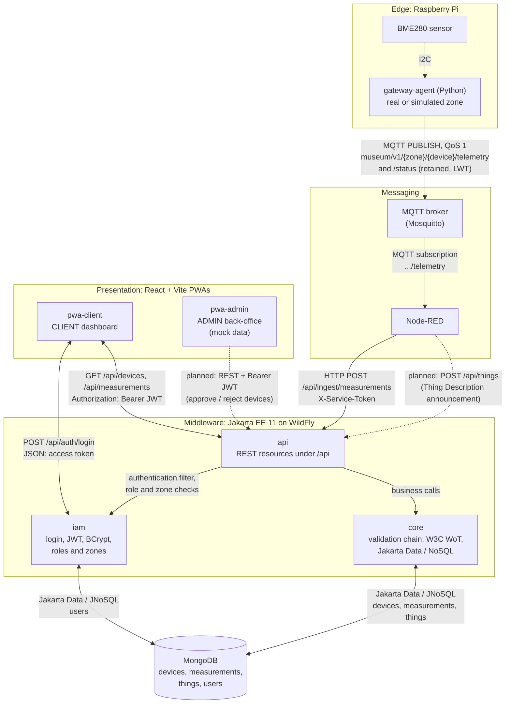
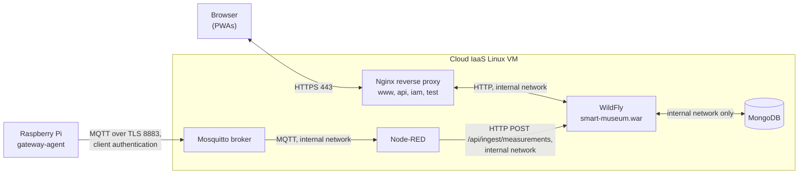

# Smart Museum: IoT Monitoring of Cultural Heritage Conditions

## 1. Project Overview

**Smart Museum** is an Internet of Things (IoT) and web platform that helps museums preserve artifacts by monitoring the environmental conditions of exhibition rooms.

Temperature, relative humidity and atmospheric pressure are measured in each zone by sensors connected to a Raspberry Pi gateway. Measurements travel through MQTT and Node-RED to a Jakarta EE **middleware**, which validates them, stores them in MongoDB and exposes them through a secured REST API. Two Progressive Web Applications (PWAs) present the data: a client dashboard for museum staff and an administration back-office.

### Main objectives

- Collect environmental measurements in several museum zones.
- Transport them reliably from the sensors to the middleware.
- Validate and store every measurement with its device, zone, source (real or simulated) and quality.
- Describe each device with a W3C Web of Things (WoT) Thing Description and require an administrator to approve new devices.
- Restrict access by role (ADMIN, CLIENT) and by zone.
- Display current and historical measurements in installable, offline-capable PWAs.

---

## 2. System Architecture

The system is organised in four layers:

1. **Edge (IoT) layer:** a BME280 sensor is read over I2C by the `gateway-agent` running on a Raspberry Pi. A second zone can be simulated by the same agent.
2. **Messaging layer:** the gateway publishes measurements to an MQTT broker (Mosquitto); Node-RED subscribes to the measurement topics, labels each measurement as `real` or `simulated`, and forwards it to the middleware over HTTP.
3. **Middleware layer:** a Jakarta EE 11 application deployed on WildFly, organised in three modules: `api` (REST resources), `iam` (identity and access management) and `core` (business logic, W3C WoT, persistence with Jakarta Data and Jakarta NoSQL). It stores its data in MongoDB.
4. **Presentation layer:** two React + Vite PWAs, `pwa-client` (CLIENT dashboard) and `pwa-admin` (ADMIN back-office).

### Technical architecture (current implementation)



**Reading the diagram**

| Notation | Meaning |
|---|---|
| Solid arrow `A → B` | Data flows from A to B; A initiates the exchange. Implemented in this repository. |
| Double arrow `A ↔ B` | Request/response: A sends the request, B returns the response. |
| Dashed arrow | Supported by the receiving side but not yet connected (see section 10). |
| Box inside *Middleware* | A module of the single WildFly deployment `smart-museum.war`, not a separate server. |

Notes on the diagram:

- The gateway publishes the device status on `.../status` (retained message, with an MQTT Last Will "offline"). The status is available on the broker; the middleware does not consume it yet.
- The client PWA never accesses MongoDB, the broker or the ingestion endpoint directly. It only calls the REST API with a short-lived JWT.
- The `X-Service-Token` used by Node-RED is a server-side secret; it is never placed in browser code.

### Path of a measurement

1. The `gateway-agent` reads the BME280 over I2C and builds one measurement per property (`temperature`, `humidity`, `pressure`), each with a UUID `measurementId` and a UTC `observedAt`.
2. It publishes each measurement with MQTT QoS 1 on `museum/v1/{zoneId}/{deviceId}/telemetry`. If the network is down, messages are queued and resent.
3. Node-RED, subscribed to the telemetry topics, sets `source` to `real` or `simulated` and sends the measurement to `POST /api/ingest/measurements` with the `X-Service-Token` header.
4. In the middleware, the `iam` service-token filter authenticates Node-RED, then the `core` validation chain checks the message: schema, device identity and zone, physical range, approved device (`active`), and property/unit declared in the device's Thing Description.
5. The measurement is stored in MongoDB through a Jakarta Data repository. A repeated `measurementId` is ignored (HTTP 200), a new one is accepted (HTTP 202).
6. The client PWA signs in through `POST /api/auth/login`, receives a JWT, and reads devices and measurements of its authorised zones through the REST API.

### Target deployment (planned for sprint S6, not yet in this repository)

The architecture document defines the following cloud deployment. The repository does not yet contain the Nginx, TLS or broker configuration files.



Only ports 443 (HTTPS) and 8883 (MQTT over TLS) are exposed; MongoDB and the broker administration stay on the internal network.

---

## 3. Technologies and Tools

| Component | Technology | Purpose |
|---|---|---|
| IoT hardware | Raspberry Pi, BME280 (I2C, 3.3 V) | Measure temperature, humidity and pressure |
| Gateway software | Python 3, `paho-mqtt`, `RPi.bme280`, systemd | Read the sensor, publish measurements, restart on failure |
| Messaging | MQTT (QoS 1), Mosquitto | Transport measurements and device status |
| Flow integration | Node-RED | Label the source and forward measurements to the middleware |
| Middleware | Java 21, Jakarta EE 11 (REST, CDI, JSON-B) | Validation, business logic and REST API |
| Persistence | Jakarta NoSQL and Jakarta Data (Eclipse JNoSQL 1.1) | Entities and repositories on MongoDB |
| Device description | W3C WoT Thing Description 1.1 (JSON-LD) | Describe device properties, events and access forms |
| Identity and access | JWT (JJWT 0.12), BCrypt (jBCrypt) | Sign-in, signed tokens, ADMIN/CLIENT roles and zones |
| Application server | WildFly 41 / 42 | Run the middleware |
| Build | Apache Maven | Dependencies, tests and WAR packaging |
| Database | MongoDB 7 (Docker) | Store devices, measurements, Thing Descriptions and accounts |
| Frontend | React, Vite, Vitest | Client and admin PWAs |
| API contract | OpenAPI 3 (`contracts/openapi.yaml`), Postman | Document and test the API |
| CI | GitHub Actions (`middleware-ci`) | Build and test the middleware on every push |

---

## 4. Main System Components

### 4.1 Edge layer: `gateway-agent`

Python agent running on the Raspberry Pi as a systemd service.

- Reads the BME280 over I2C and publishes one MQTT message per property.
- Real device: `bme280-01`, zone `salle-01`, gateway `gw-01`.
- Simulated second zone: `sim-bme280-02`, zone `salle-02`, gateway `gw-sim`. A simulated sensor must use a `sim-`/`gw-sim` identifier, so a simulated value can never be presented as real.
- Publishes its status on `.../status`: `online` at connection, `offline` with reason `lwt` (published by the broker) or `shutdown`.
- Reconnects automatically and queues up to 5,000 messages during network outages.

Details: [`gateway-agent/README.md`](gateway-agent/README.md).

### 4.2 Messaging layer: MQTT and Node-RED

| Topic | QoS | Content |
|---|---|---|
| `museum/v1/{zoneId}/{deviceId}/telemetry` | 1 | One measurement (JSON) |
| `museum/v1/{zoneId}/{deviceId}/status` | 1, retained | `online` / `offline` |
| `museum/v1/{zoneId}/{deviceId}/td` | 1 | Planned: Thing Description announcement of a new device |

Node-RED subscribes to the telemetry topics, adds `source` (`real` or `simulated`) and calls the middleware ingestion endpoint with the service token.

### 4.3 Middleware layer: Jakarta EE (`middleware/`)

A single WildFly deployment, `smart-museum.war`, organised in three modules (`middleware/src/main/java/tn/supcom/museum/`):

| Module | Responsibility | Main packages |
|---|---|---|
| `api` | REST resources under `/api` (devices, measurements, Thing Descriptions, ingestion, health), JAX-RS configuration, CORS, JSON error mapping | `api.rest`, `api.config`, `api.error` |
| `iam` | Sign-in, user accounts, BCrypt password hashing, JWT issue and validation, authentication filters (user and service token), ADMIN/CLIENT and zone authorization | `iam.security`, `iam.rest`, `iam.entity`, `iam.data`, `iam.repository`, `iam.model` |
| `core` | Measurement validation chain, W3C WoT Thing Descriptions and device discovery, Jakarta NoSQL entities and Jakarta Data repositories | `core.validation`, `core.wot`, `core.entity`, `core.data`, `core.repository`, `core.model` |

Dependencies go one way: `api` uses `iam` and `core`; `iam` uses `core`; `core` depends on neither.

**Measurement validation chain** (`core.validation`):

| Step | Check | Rejection |
|---|---|---|
| 1. Schema | JSON structure, UUID, ISO dates, known property | 400 |
| 2. Device identity | Device exists and belongs to the announced zone | 403 |
| 3. Range | Value within physical limits; quality computed | 422 |
| 4. Trust | Device is `active` (approved by an ADMIN) | 403 |
| 5. Affordance | Property and unit declared in the device's Thing Description | 422 |
| 6. Persistence | Stored; duplicate `measurementId` detected | 200 (duplicate) / 202 (accepted) |

**Device discovery** (`core.wot`): a new device is registered as `pending` with its Thing Description, then approved (`active`) or rejected by an ADMIN. Only `active` devices can send measurements.

Details: [`middleware/README.md`](middleware/README.md).

### 4.4 Database layer: MongoDB

| Collection | Content |
|---|---|
| `devices` | Device identifier, type, zone, gateway, status (`pending`, `active`, `rejected`, `offline`), link to its Thing Description, last activity |
| `measurements` | One document per measurement: device, zone, property, value, unit, `observedAt`, `receivedAt`, source, quality |
| `things` | W3C WoT Thing Description of each device (JSON-LD) and its declared properties and units |
| `users` | Accounts: name, email, BCrypt hash, role (`ADMIN` / `CLIENT`), status, authorised zones |

### 4.5 Presentation layer: PWAs

**`pwa-client`** (front office, CLIENT role)

- Sign-in with email and password; the JWT is sent as `Authorization: Bearer` on each request.
- Conservation dashboard by zone, device information, latest measurements, freshness indicator.
- Historical measurements with filters, chart and table.
- Loading, empty, error and offline states; installable PWA with a service worker.
- `mock` mode (demonstration data) and `api` mode (real middleware).

**`pwa-admin`** (back office, ADMIN role)

- Device inventory, pending devices, zones, thresholds and users views.
- Currently works on **mock data only**: approval and rejection are simulated in the browser. Connection to the middleware (`/api/devices/{id}/approve`, `/reject`) is planned.

Details: [`DOCS/pwa-client.md`](DOCS/pwa-client.md) and [`DOCS/ADMIN_PWA.md`](DOCS/ADMIN_PWA.md).

---

## 5. Repository Structure

```text
SMART-MUSEUM/
├── gateway-agent/          Raspberry Pi agent (Python): sensor reading, MQTT publishing, simulator
│   ├── src/gateway_agent/
│   ├── systemd/
│   └── tests/
├── middleware/             Jakarta EE middleware (Maven project, smart-museum.war)
│   ├── src/main/java/tn/supcom/museum/
│   │   ├── api/            REST resources, JAX-RS configuration, CORS, error mapping
│   │   ├── iam/            accounts, JWT, BCrypt, authentication and authorization
│   │   └── core/           validation, W3C WoT, Jakarta NoSQL entities, Jakarta Data repositories
│   ├── src/test/java/      unit tests (same module layout)
│   ├── docker-compose.dev.yml   MongoDB for local development
│   ├── .env.example
│   └── pom.xml
├── pwa-client/             CLIENT PWA (React + Vite)
├── pwa-admin/              ADMIN PWA prototype (React + Vite, mock data)
├── contracts/openapi.yaml  REST API contract
├── postman/                Postman collection
├── DOCS/                   architecture document, hand-off documents, diagrams
├── .github/workflows/      CI (middleware-ci)
├── ATTRIBUTION.md          declaration of AI use and attribution
└── README.md
```

The Node-RED flow is not yet versioned in this repository.

### Team responsibilities

| Member | Scope |
|---|---|
| P1: IoT | Sensors, `gateway-agent`, MQTT, Node-RED |
| P2: Middleware | Jakarta EE middleware (`api`, `iam`, `core`), MongoDB persistence, API contract |
| P3: Frontend | `pwa-client` and `pwa-admin` |

---

## 6. Middleware REST API

Base path: `/api`. Full contract: [`contracts/openapi.yaml`](contracts/openapi.yaml).

| Method | Endpoint | Authentication | Description |
|---|---|---|---|
| GET | `/api/health` | none | Middleware and MongoDB status |
| POST | `/api/auth/login` | none | Sign in; returns a JWT and the account |
| POST | `/api/users` | Bearer, ADMIN | Create a CLIENT account with its zones |
| GET | `/api/devices?status=` | Bearer | Devices (CLIENT: only its zones) |
| GET | `/api/devices/{deviceId}` | Bearer | Device detail, `Link` header to its Thing Description |
| POST | `/api/devices/{deviceId}/approve` | Bearer, ADMIN | Approve a device (`pending` → `active`) |
| POST | `/api/devices/{deviceId}/reject` | Bearer, ADMIN | Reject a device |
| GET | `/api/measurements/latest?zoneId=` | Bearer | Latest measurement per device and property in a zone |
| GET | `/api/measurements?deviceId=&property=&from=&to=&limit=` | Bearer | Measurement history |
| GET | `/api/things`, `/api/things/{deviceId}` | Bearer, ADMIN | W3C WoT Thing Descriptions (`application/td+json`) |
| POST | `/api/things` | `X-Service-Token` | Thing Description announcement (discovery) |
| POST | `/api/ingest/measurements` | `X-Service-Token` | Measurement ingestion (Node-RED) |

**Response codes:** 401 = missing or invalid credentials; 403 = authenticated but not allowed (role or zone); errors are returned as `{"error": "...", "message": "..."}`.

### Examples

```http
GET http://localhost:8080/api/health
```

```json
{ "status": "UP", "mongo": "UP" }
```

```http
POST http://localhost:8080/api/auth/login
Content-Type: application/json

{ "email": "<ACCOUNT_EMAIL>", "password": "<ACCOUNT_PASSWORD>" }
```

```json
{ "accessToken": "<JWT>", "tokenType": "Bearer", "expiresIn": 900,
  "user": { "userId": "...", "name": "...", "email": "...", "role": "CLIENT", "status": "active", "zoneIds": ["salle-01"] } }
```

```http
GET http://localhost:8080/api/measurements/latest?zoneId=salle-01
Authorization: Bearer <JWT>
```

---

## 7. Installation and Local Development

### Prerequisites

- Git
- Docker (Docker Desktop, or Docker Engine in WSL/Ubuntu)
- Java JDK 21 and Apache Maven
- WildFly 41 or 42
- Node.js and npm

### Step 1: Clone the repository

```bash
git clone https://github.com/sourourjaouadi/SMART-MUSEUM.git
cd SMART-MUSEUM
```

### Step 2: Start MongoDB

```bash
docker compose -f middleware/docker-compose.dev.yml up -d
docker ps          # the museum-mongo container must be "Up"
```

### Step 3: Build the middleware

```bash
cd middleware
mvn clean package  # runs the unit tests and produces target/smart-museum.war
```

### Step 4: Configure and start WildFly

Copy `middleware/target/smart-museum.war` into `<WILDFLY_HOME>/standalone/deployments/`, then define the variables below **in the terminal that starts WildFly** (see `middleware/.env.example`).

| Variable | Example | Role |
|---|---|---|
| `INGEST_SERVICE_TOKEN` | random secret | Service token expected from Node-RED |
| `JWT_SIGNING_KEY_BASE64` | 32 random bytes, Base64 | JWT signing key (server only) |
| `CORS_ALLOWED_ORIGINS` | `http://localhost:5173,http://localhost:5174` | Allowed PWA origins |
| `BOOTSTRAP_ADMIN_NAME`, `_EMAIL`, `_PASSWORD` | set together, first start only | Creates the first ADMIN account |

Linux / WSL:

```bash
export INGEST_SERVICE_TOKEN=dev-token
export JWT_SIGNING_KEY_BASE64=$(openssl rand -base64 32)
export CORS_ALLOWED_ORIGINS=http://localhost:5173,http://localhost:5174
bash <WILDFLY_HOME>/bin/standalone.sh
```

Windows PowerShell:

```powershell
$env:INGEST_SERVICE_TOKEN = "dev-token"
$env:JWT_SIGNING_KEY_BASE64 = [Convert]::ToBase64String([Security.Cryptography.RandomNumberGenerator]::GetBytes(32))
$env:CORS_ALLOWED_ORIGINS = "http://localhost:5173,http://localhost:5174"
& "<WILDFLY_HOME>\bin\standalone.bat"
```

Wait for `Deployed "smart-museum.war"`.

### Step 5: Verify the middleware

```bash
curl http://localhost:8080/api/health                                       # {"status":"UP","mongo":"UP"}
curl -s -o /dev/null -w "%{http_code}\n" http://localhost:8080/api/devices   # 401 without a token
```

The middleware creates two active test devices with their Thing Descriptions at start-up (`bme280-01` in `salle-01`, `sim-bme280-02` in `salle-02`); disable with `SEED_DEVICES=false`.

### Step 6: Start the client PWA

```bash
cd pwa-client
npm install
cp .env.example .env    # Windows: copy .env.example .env
npm run dev             # http://localhost:5173
```

| Variable | Description | Default |
|---|---|---|
| `VITE_DATA_MODE` | `mock` (demonstration data) or `api` (real middleware) | `mock` |
| `VITE_API_BASE_URL` | Middleware base URL | `http://localhost:8080` |
| `VITE_API_TIMEOUT_MS` | Request timeout | `10000` |
| `VITE_REFRESH_INTERVAL_MS` | Dashboard refresh interval | `15000` |
| `VITE_STALE_AFTER_MS` | Age after which a measurement is shown as stale | `900000` |

`VITE_*` values are included in the browser bundle: never put a token, password or signing key in them.

### Step 7 (optional): Start the admin PWA

```bash
cd pwa-admin
npm install
npm run dev             # uses the next free port, e.g. http://localhost:5174
```

### Step 8 (optional): Run the gateway agent

See [`gateway-agent/README.md`](gateway-agent/README.md) for the Raspberry Pi installation, the simulated zone and the systemd service. The agent needs a reachable MQTT broker, and Node-RED must forward the telemetry to the middleware with the service token.

---

## 8. Testing and Validation

| Component | Command | Content |
|---|---|---|
| Middleware | `cd middleware && mvn clean package` | 41 unit tests: validation chain, Thing Description validator, affordances, JWT, BCrypt, authorization, security bindings |
| Gateway agent | `cd gateway-agent && python3 -m pytest -q` | Configuration, measurement building, sensor, MQTT publisher (no Raspberry Pi or broker needed) |
| Client PWA | `cd pwa-client && npm test && npm run build` | Components, API client, session, history dashboard |
| Admin PWA | `cd pwa-admin && npm test && npm run build` | Admin views and mock service |

The middleware is also built and tested by GitHub Actions (`middleware-ci`) on every push to `middleware/`.

**Database inspection:**

```bash
docker exec -it museum-mongo mongosh museum
```

```javascript
show collections
db.devices.find()
db.measurements.countDocuments()
```

The API can also be exercised with the Postman collection in `postman/`.

A healthy middleware does not prove that the full IoT chain works: end-to-end validation also requires the gateway, the broker and Node-RED to deliver measurements to `/api/ingest/measurements`.

---

## 9. Security

- **Two separate authentication paths:** people use a short-lived JWT (`Authorization: Bearer`, 15 minutes by default) obtained from `/api/auth/login`; Node-RED uses the `X-Service-Token` secret. A user token is not accepted on ingestion routes, and the service token is never sent to browsers.
- **Passwords** are stored only as BCrypt hashes (cost 12). Login answers in constant time so that it does not reveal which emails have an account.
- **Authorization is enforced by the middleware** on each endpoint: ADMIN-only operations, and CLIENT access limited to the zones stored in the account (not to zones claimed by the token or the browser).
- **Device trust:** only devices approved by an ADMIN (`active`) can send measurements, and only for the properties and units declared in their Thing Description.
- **Secrets** (`INGEST_SERVICE_TOKEN`, `JWT_SIGNING_KEY_BASE64`, bootstrap password) are environment variables, outside Git and never logged.
- **CORS** is limited to the configured PWA origins.
- In deployment, HTTPS (443) and MQTT over TLS (8883) are required and MongoDB must stay on the internal network (section 2, target deployment).

---

## 10. Current Development Status

### Implemented

- Gateway agent: BME280 reading, MQTT QoS 1 publishing, status and LWT, reconnection, simulated second zone, systemd service, unit tests.
- Middleware organised in `api`, `iam` and `core`, deployed on WildFly.
- Measurement ingestion with the six-step validation chain and idempotency.
- Persistence with Jakarta NoSQL entities and Jakarta Data repositories on MongoDB.
- W3C WoT Thing Descriptions, device discovery with ADMIN approval, RFC 8288 `Link` header to the Thing Description.
- Accounts, BCrypt, JWT sign-in, ADMIN/CLIENT roles and zone-based authorization.
- Client PWA connected to the middleware (sign-in, devices, latest and historical measurements), with mock mode, offline states and PWA installation.
- Admin PWA prototype on mock data.
- Middleware CI on GitHub Actions.

### Not yet connected

- The Node-RED flow is not versioned in this repository.
- The gateway does not yet publish Thing Description announcements on `.../td`; the middleware endpoint `POST /api/things` is ready.
- The admin PWA is not yet connected to the middleware.
- The device status published on MQTT is not yet consumed by the middleware.
- Cloud deployment (Nginx, HTTPS, MQTT over TLS) is planned for sprint S6.

---

## 11. Future Improvements

- Version the Node-RED flow and publish Thing Descriptions from the gateway.
- Connect the admin PWA to the approval, rejection and account endpoints.
- Zone and threshold management, alerts and notifications to museum staff.
- Real-time updates to the PWAs (WebSocket).
- AI-assisted analysis of measurements (planned in sprint S5).
- Cloud deployment behind Nginx with HTTPS and MQTT over TLS.

These items are planned and are not implemented functionality.

---

## 12. Conclusion

Smart Museum connects environmental sensors, an MQTT messaging chain, a Jakarta EE middleware and two PWAs to monitor and protect museum collections. Its layered architecture separates data collection, messaging, middleware processing (`api`, `iam`, `core`), persistence and presentation, so that each part can be developed, tested and secured independently.
