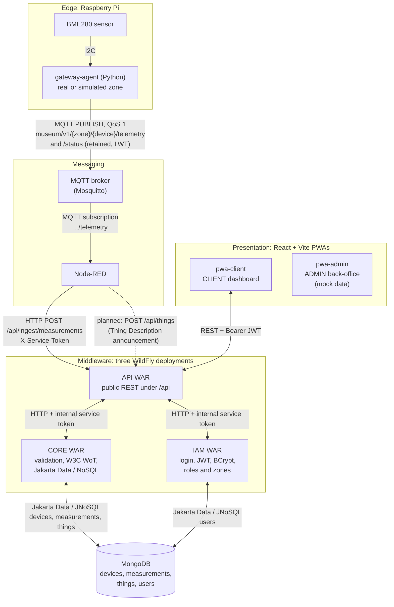

# Smart Museum: IoT Monitoring of Cultural Heritage Conditions

## 1. Project Overview

**Smart Museum** is an Internet of Things (IoT) and web platform that helps museums preserve artifacts by monitoring the environmental conditions of exhibition rooms.

Temperature, relative humidity and atmospheric pressure are measured in each zone by sensors connected to a Raspberry Pi gateway. Measurements travel through MQTT and Node-RED to a Jakarta EE **middleware**, which validates them, stores them in MongoDB and exposes them through a secured REST API. Two Progressive Web Applications (PWAs) present the data: a client dashboard for museum staff and an administration back-office.

### Main objectives

- Collect environmental measurements in several museum zones.
- Transport them reliably from the sensors to the middleware.
- Validate and store every measurement with its device, zone, source (real or simulated) and quality.
- Describe each device with a W3C Web of Things (WoT) Thing Description and require an administrator to approve new devices.
- Restrict access by role (ADMIN, CLIENT) and by zone.
- Display current and historical measurements in installable, offline-capable PWAs.

---

## 2. System Architecture

The system is organised in four layers:

1. **Edge (IoT) layer:** a BME280 sensor is read over I2C by the `gateway-agent` running on a Raspberry Pi. A second zone can be simulated by the same agent.
2. **Messaging layer:** the gateway publishes measurements to an MQTT broker (Mosquitto); Node-RED subscribes to the measurement topics, labels each measurement as `real` or `simulated`, and forwards it to the middleware over HTTP.
3. **Middleware layer:** three independently deployable Jakarta EE 11 WAR applications on WildFly: API (PWA-facing REST endpoints), IAM (identity and access management), and CORE (museum business logic, WoT, and persistence with Jakarta Data/Jakarta NoSQL). API communicates with IAM and CORE over authenticated HTTP. A shared Contracts JAR carries request/response types.
4. **Presentation layer:** two React + Vite PWAs, `pwa-client` (CLIENT dashboard) and `pwa-admin` (ADMIN back-office).

### Technical architecture (current implementation)



**Reading the diagram**

| Notation | Meaning |
|---|---|
| Solid arrow `A → B` | Data flows from A to B; A initiates the exchange. Implemented in this repository. |
| Double arrow `A ↔ B` | Request/response: A sends the request, B returns the response. |
| Dashed arrow | Supported by the receiving side but not yet connected (see section 10). |
| Box inside *Middleware* | An independently deployable WAR. API-to-service calls use internal HTTP and a shared service token. |

Notes on the diagram:

- The gateway publishes the device status on `.../status` (retained message, with an MQTT Last Will "offline"). The status is available on the broker; the middleware does not consume it yet.
- The client PWA never accesses MongoDB, the broker or the ingestion endpoint directly. It only calls the REST API with a short-lived JWT.
- The `X-Service-Token` used by Node-RED is a server-side secret; it is never placed in browser code.

### Path of a measurement

1. The `gateway-agent` reads the BME280 over I2C and builds one measurement per property (`temperature`, `humidity`, `pressure`), each with a UUID `measurementId` and a UTC `observedAt`.
2. It publishes each measurement with MQTT QoS 1 on `museum/v1/{zoneId}/{deviceId}/telemetry`. If the network is down, messages are queued and resent.
3. Node-RED, subscribed to the telemetry topics, sets `source` to `real` or `simulated` and sends the measurement to `POST /api/ingest/measurements` with the `X-Service-Token` header.
4. API authenticates the ingest service token, then calls CORE over authenticated internal HTTP. CORE validates schema, device identity and zone, physical range, approved device (`active`), and property/unit declared in the device's Thing Description.
5. The measurement is stored in MongoDB through a Jakarta Data repository. A repeated `measurementId` is ignored (HTTP 200), a new one is accepted (HTTP 202).
6. The Client signs in through API `POST /api/auth/login`. API asks IAM to validate credentials and return a JWT. For protected requests API asks IAM to validate the token and current account state, then calls CORE for authorized device and measurement data.

### Production cloud target (not yet implemented)

The architecture document defines the following production cloud target. Local
WildFly HTTPS for development is implemented, but production Nginx, certificate,
and broker configuration is not present in this repository.


Only ports 443 (HTTPS) and 8883 (MQTT over TLS) are exposed; MongoDB and the broker administration stay on the internal network.

---

## 3. Technologies and Tools

| Component | Technology | Purpose |
|---|---|---|
| IoT hardware | Raspberry Pi, BME280 (I2C, 3.3 V) | Measure temperature, humidity and pressure |
| Gateway software | Python 3, `paho-mqtt`, `RPi.bme280`, systemd | Read the sensor, publish measurements, restart on failure |
| Messaging | MQTT (QoS 1), Mosquitto | Transport measurements and device status |
| Flow integration | Node-RED | Label the source and forward measurements to the middleware |
| Middleware | Java 21, Jakarta EE 11 (REST, CDI, JSON-B) | Validation, business logic and REST API |
| Persistence | Jakarta NoSQL and Jakarta Data (Eclipse JNoSQL 1.1) | Entities and repositories on MongoDB |
| Device description | W3C WoT Thing Description 1.1 (JSON-LD) | Describe device properties, events and access forms |
| Identity and access | JWT (JJWT 0.12), BCrypt (jBCrypt) | Sign-in, signed tokens, ADMIN/CLIENT roles and zones |
| Application server | WildFly 41 / 42 | Run the middleware |
| Build | Apache Maven | Dependencies, tests and WAR packaging |
| Database | MongoDB 7 (Docker) | Store devices, measurements, Thing Descriptions and accounts |
| Frontend | React, Vite, Vitest | Client and admin PWAs |
| API contract | OpenAPI 3 (`contracts/openapi.yaml`), Postman | Document and test the API |
| CI | GitHub Actions (`middleware-ci`) | Build and test the middleware on every push |

---

## 4. Main System Components

### 4.1 Edge layer: `gateway-agent`

Python agent running on the Raspberry Pi as a systemd service.

- Reads the BME280 over I2C and publishes one MQTT message per property.
- Real device: `bme280-01`, zone `salle-01`, gateway `gw-01`.
- Simulated second zone: `sim-bme280-02`, zone `salle-02`, gateway `gw-sim`. A simulated sensor must use a `sim-`/`gw-sim` identifier, so a simulated value can never be presented as real.
- Publishes its status on `.../status`: `online` at connection, `offline` with reason `lwt` (published by the broker) or `shutdown`.
- Reconnects automatically and queues up to 5,000 messages during network outages.

Details: [`gateway-agent/README.md`](gateway-agent/README.md).

### 4.2 Messaging layer: MQTT and Node-RED

| Topic | QoS | Content |
|---|---|---|
| `museum/v1/{zoneId}/{deviceId}/telemetry` | 1 | One measurement (JSON) |
| `museum/v1/{zoneId}/{deviceId}/status` | 1, retained | `online` / `offline` |
| `museum/v1/{zoneId}/{deviceId}/td` | 1 | Planned: Thing Description announcement of a new device |

Node-RED subscribes to the telemetry topics, adds `source` (`real` or `simulated`) and calls the middleware ingestion endpoint with the service token.

### 4.3 Middleware layer: Jakarta EE (`middleware/`)

`middleware/` is a Maven parent project that builds a shared Contracts JAR and
three separately deployed WildFly WARs. Source is split by Maven module; the
public API artifact remains `smart-museum.war`:

| Module | Responsibility | Main packages |
|---|---|---|
| `contracts` (JAR) | Shared serialized DTOs, errors, internal-service binding | `tn.supcom.museum.contracts` and shared model packages |
| `api` (WAR) | Public REST resources, CORS, error mapping, authentication bridge, HTTP clients to CORE/IAM | `api.rest`, `api.config`, `api.error`, `api.service` |
| `iam` (WAR) | Sign-in, user accounts, BCrypt, JWT issue/validation, active-account, role and zone authorization | `iam.security`, `iam.rest`, `iam.entity`, `iam.data`, `iam.repository` |
| `core` (WAR) | Measurement validation, W3C WoT, discovery, Jakarta NoSQL entities and Jakarta Data repositories | `core.validation`, `core.wot`, `core.entity`, `core.data`, `core.repository` |

The services do not share CDI beans. API calls IAM and CORE over HTTP using
`X-Internal-Service-Token`; Contracts is packaged into the applications. CORE
owns `devices`, `measurements`, and `things`; IAM owns `users`; API has no
MongoDB collections.

**Measurement validation chain** (`core.validation`):

| Step | Check | Rejection |
|---|---|---|
| 1. Schema | JSON structure, UUID, ISO dates, known property | 400 |
| 2. Device identity | Device exists and belongs to the announced zone | 403 |
| 3. Range | Value within physical limits; quality computed | 422 |
| 4. Trust | Device is `active` (approved by an ADMIN) | 403 |
| 5. Affordance | Property and unit declared in the device's Thing Description | 422 |
| 6. Persistence | Stored; duplicate `measurementId` detected | 200 (duplicate) / 202 (accepted) |

**Device discovery** (`core.wot`): a new device is registered as `pending` with its Thing Description, then approved (`active`) or rejected by an ADMIN. Only `active` devices can send measurements.

Details: [`middleware/README.md`](middleware/README.md) and the
[M2 implementation handoff](DOCS/M2_IMPLEMENTATION_HANDOFF.md).

### 4.4 Database layer: MongoDB

| Collection | Content |
|---|---|
| `devices` | Device identifier, type, zone, gateway, status (`pending`, `active`, `rejected`, `offline`), link to its Thing Description, last activity, optional own WGS84 location |
| `zones` | Zone identifier, name, WGS84 latitude/longitude and floor |
| `measurements` | One document per measurement: device, zone, property, value, unit, `observedAt`, `receivedAt`, source, quality |
| `things` | W3C WoT Thing Description of each device (JSON-LD) and its declared properties and units |
| `users` | Accounts: name, email, BCrypt hash, role (`ADMIN` / `CLIENT`), status, authorised zones |

### 4.5 Presentation layer: PWAs

**`pwa-client`** (front office, CLIENT role)

- Sign-in with email and password; the JWT is sent as `Authorization: Bearer` on each request.
- Conservation dashboard by zone, device information, latest measurements, freshness indicator.
- Historical measurements with filters, chart and table.
- Loading, empty, error and offline states; installable PWA with a service worker.
- `mock` mode (demonstration data) and `api` mode (real middleware).

**`pwa-admin`** (back office, ADMIN role)

- Device inventory, pending devices, zones, thresholds and users views.
- Currently works on **mock data only**: approval and rejection are simulated in the browser. Connection to the middleware (`/api/devices/{id}/approve`, `/reject`) is planned.

Details: [`DOCS/pwa-client.md`](DOCS/pwa-client.md) and [`DOCS/ADMIN_PWA.md`](DOCS/ADMIN_PWA.md).

---

## 5. Repository Structure

```text
SMART-MUSEUM/
|-- middleware/
|   |-- pom.xml                 Maven parent aggregator
|   |-- contracts/              shared DTO/error JAR
|   |-- core/                   CORE service WAR
|   |-- iam/                    IAM service WAR
|   |-- api/                    public API WAR (smart-museum.war)
|   |-- config/                 non-secret DEV/PROD templates
|   `-- docker-compose.m2-sandbox.yml
|-- deployment/                 WildFly build, deploy, HTTPS and acceptance scripts
|-- pwa-client/                 CLIENT React/Vite app and static WAR
|-- pwa-admin/                  ADMIN React/Vite app and static WAR (mock data)
|-- gateway-agent/              Raspberry Pi Python sensor agent
|-- contracts/openapi.yaml      public API contract
|-- postman/                    Postman collection
`-- DOCS/                       architecture, reports and handoffs
```

The Node-RED flow is not versioned in this repository.
### Team responsibilities

| Member | Scope |
|---|---|
| P1: IoT | Sensors, `gateway-agent`, MQTT, Node-RED |
| P2: Middleware | Jakarta EE middleware (`api`, `iam`, `core`), MongoDB persistence, API contract |
| P3: Frontend | `pwa-client` and `pwa-admin` |

---

## 6. Middleware REST API

Base path: `/api`. Full contract: [`contracts/openapi.yaml`](contracts/openapi.yaml).

| Method | Endpoint | Authentication | Description |
|---|---|---|---|
| GET | `/api/health` | none | Middleware and MongoDB status |
| POST | `/api/auth/login` | none | Sign in; returns a JWT and the account |
| POST | `/api/users` | Bearer, ADMIN | Create a CLIENT account with its zones |
| GET | `/api/devices?status=` | Bearer | Devices (CLIENT: only its zones) |
| GET | `/api/devices/{deviceId}` | Bearer | Device detail, `Link` header to its Thing Description |
| POST | `/api/devices/{deviceId}/approve` | Bearer, ADMIN | Approve a device (`pending` → `active`) |
| POST | `/api/devices/{deviceId}/reject` | Bearer, ADMIN | Reject a device |
| PUT / DELETE | `/api/devices/{deviceId}/location` | Bearer, ADMIN | Set or clear an approved device's own WGS84 location (its `zoneId` never changes) |
| GET | `/api/zones`, `/api/zones/{zoneId}` | Bearer | Zones and their WGS84 coordinates (CLIENT: only its zones) |
| PUT | `/api/zones/{zoneId}` | Bearer, ADMIN | Create or update a zone's name and coordinates |
| GET | `/api/measurements/latest?zoneId=` | Bearer | Latest measurement per device and property in a zone |
| GET | `/api/measurements?deviceId=&property=&from=&to=&limit=` | Bearer | Measurement history |
| GET | `/api/things`, `/api/things/{deviceId}` | Bearer, ADMIN | W3C WoT Thing Descriptions (`application/td+json`) |
| POST | `/api/things` | `X-Service-Token` | Thing Description announcement (discovery) |
| POST | `/api/ingest/measurements` | `X-Service-Token` | Measurement ingestion (Node-RED) |

**Response codes:** 401 = missing or invalid credentials; 403 = authenticated but not allowed (role or zone); errors are returned as `{"error": "...", "message": "..."}`.

### Examples

```http
GET https://api.smartmuseum.test:8443/api/health
```

```json
{ "status": "UP", "mongo": "UP" }
```

```http
POST https://api.smartmuseum.test:8443/api/auth/login
Content-Type: application/json

{ "email": "<ACCOUNT_EMAIL>", "password": "<ACCOUNT_PASSWORD>" }
```

```json
{ "accessToken": "<JWT>", "tokenType": "Bearer", "expiresIn": 900,
  "user": { "userId": "...", "name": "...", "email": "...", "role": "CLIENT", "status": "active", "zoneIds": ["salle-01"] } }
```

```http
GET https://api.smartmuseum.test:8443/api/measurements/latest?zoneId=salle-01
Authorization: Bearer <JWT>
```

---

## 7. Installation and Local Development

For the current M2 local topology and full Windows setup guide, see
[`deployment/README.md`](deployment/README.md) and the
[M2 implementation handoff](DOCS/M2_IMPLEMENTATION_HANDOFF.md).

### Prerequisites

- Git, Docker Desktop with Compose, Node.js/npm, Java 21, and Maven.
- WildFly 42 (WildFly 41 may also be supported by the middleware build).
- mkcert and OpenSSL for the local development certificate.
- Windows PowerShell for the repository deployment scripts.

### Isolated DEV middleware

Run from the repository root. The M2 sandbox is separate from the original
backend Mongo container/database/volume:

```powershell
docker compose -f middleware/docker-compose.m2-sandbox.yml up -d
docker exec museum-m2-sandbox-mongo mongosh --quiet --eval "db.adminCommand({ping:1}).ok"
```

If `middleware/config/dev.env` does not exist, initialize it once. The
initializer creates random secrets and can prompt securely for a sandbox
bootstrap administrator; do not pass passwords on the command line:

```powershell
.\deployment\initialize-dev-environment.ps1 -CreateBootstrapAdmin
.\deployment\prepare-local-https.ps1
$wildflyHome = 'C:\path\to\wildfly-42.0.0.Final'
.\deployment\configure-wildfly-https.ps1 -WildFlyHome $wildflyHome
.\deployment\build-all.ps1
```

Configure the three local Windows hosts-file aliases from
`deployment/README.md` if they are not already present. TLS configuration
must be ready before WildFly starts. In a dedicated PowerShell window run:

```powershell
.\deployment\start-wildfly.ps1 -Profile dev -WildFlyHome $wildflyHome
```

After WildFly starts, apply any missing Undertow host resources:

```powershell
.\deployment\configure-wildfly-hosts.ps1 -WildFlyHome $wildflyHome
```

Use the documented deployment wrappers and verified current API WAR backup
when deploying or replacing applications. Do not copy an API WAR over a
live deployment or use the original `museum` Mongo database for M2 tests.

### Browser URLs and health

- Client: `https://smartmuseum.test:8443/`
- Admin: `https://admin.smartmuseum.test:8443/` (currently mock-only)
- API health: `https://api.smartmuseum.test:8443/api/health`
- CORE health: `https://localhost:8443/core/health`
- IAM health: `https://localhost:8443/iam/health`

Use the locally trusted certificate in a normal browser. Windows Schannel
curl can report a revocation-check limitation for a local mkcert CA; do not
disable TLS validation. Use OpenSSL with `%LOCALAPPDATA%\mkcert\rootCA.pem`
as documented in the deployment guide.

### Optional PWA development servers

The Vite Client defaults to mock mode. For local work:

```powershell
Push-Location pwa-client
npm ci
npm test
npm run dev
Pop-Location
```

Set `VITE_DATA_MODE=api` in local frontend configuration only when testing
against a running backend; its CORS list must include the exact Vite origin.
Frontend `VITE_*` variables are public and must never contain server secrets.

The Admin Vite app can be started similarly from `pwa-admin`; its actions
remain mock-only and are not connected to the API.

See [`gateway-agent/README.md`](gateway-agent/README.md) for Raspberry Pi
installation and sensor integration. The Node-RED flow is not versioned
here, so the full physical-device-to-Mongo chain is not reproducible from
this repository alone.

---

## 8. Testing and Validation

| Component | Command | Recorded/current evidence |
|---|---|---|
| Middleware modules | `mvn -f middleware/pom.xml clean verify` | 47 Maven tests passed in the M2 acceptance build (CORE 33, IAM 9, API 5). |
| Full frontend + middleware build | `.\deployment\build-all.ps1` (PowerShell) | Client Node 40, Client Vitest 10, Admin Vitest 13; five WARs packaged. |
| Gateway agent | `cd gateway-agent && python3 -m pytest -q` | Gateway unit tests; no Raspberry Pi or broker needed for unit tests. |
| Runtime integration | `.\deployment\test-m2-runtime.ps1 -ConfirmSandboxWrites` | Auth, roles/zones, CORS, service tokens, Things, measurements, health and deployments; writes only to the isolated DEV sandbox. |

For PowerShell run the full build and runtime test as:

```powershell
.\deployment\build-all.ps1
.\deployment\test-m2-runtime.ps1 -ConfirmSandboxWrites
```

The runtime acceptance script creates users, Things, and measurements in
`museum_m2_sandbox` and leaves the test records there. It refuses to run if
DEV is not configured for `localhost:27018/museum_m2_sandbox`. Never aim
these checks at the original `museum` database.

Inspect the sandbox only with:

```powershell
docker exec -it museum-m2-sandbox-mongo mongosh museum_m2_sandbox
```

A healthy middleware does not prove the physical IoT chain works: the
gateway, MQTT broker, and Node-RED flow must also be configured. The
Node-RED flow is not currently versioned in this repository.

---

## 9. Security

- **Two separate authentication paths:** people use a short-lived JWT (`Authorization: Bearer`, 15 minutes by default) obtained from `/api/auth/login`; Node-RED uses the `X-Service-Token` secret. A user token is not accepted on ingestion routes, and the service token is never sent to browsers.
- **Passwords** are stored only as BCrypt hashes (cost 12). Login answers in constant time so that it does not reveal which emails have an account.
- **Authorization is enforced by the middleware** on each endpoint: ADMIN-only operations, and CLIENT access limited to the zones stored in the account (not to zones claimed by the token or the browser).
- **Device trust:** only devices approved by an ADMIN (`active`) can send measurements, and only for the properties and units declared in their Thing Description.
- **Secrets** (`INGEST_SERVICE_TOKEN`, `JWT_SIGNING_KEY_BASE64`, bootstrap password) are environment variables, outside Git and never logged.
- **CORS** is limited to the configured PWA origins.
- Local WildFly development uses HTTPS on 8443 with a current-user-trusted mkcert certificate. Production still requires managed HTTPS (typically 443), MQTT over TLS (8883), private MongoDB access, and production secrets.

---

## 10. Current Development Status

### Implemented

- Gateway agent: BME280 reading, MQTT QoS 1 publishing, status and LWT, reconnection, simulated second zone, systemd service, unit tests.
- Middleware deployed as separate `smart-museum-core.war`, `smart-museum-iam.war`, and `smart-museum.war` applications, with API-to-service HTTP protected by the internal service token.
- Measurement ingestion with the six-step validation chain and idempotency.
- Persistence with Jakarta NoSQL entities and Jakarta Data repositories on MongoDB.
- W3C WoT Thing Descriptions, device discovery with ADMIN approval, RFC 8288 `Link` header to the Thing Description.
- Accounts, BCrypt, JWT sign-in, ADMIN/CLIENT roles and zone-based authorization.
- Geolocation: WGS84 zone coordinates and device location (own or inherited from the zone); DEV seeds sample Tunis coordinates. See [`middleware/README.md`](middleware/README.md).
- Client PWA connected to the middleware (sign-in, devices, latest and historical measurements), with mock mode, offline states and PWA installation.
- Admin PWA prototype on mock data.
- Middleware CI on GitHub Actions.

### Not yet connected

- The Node-RED flow is not versioned in this repository.
- The gateway does not yet publish Thing Description announcements on `.../td`; the middleware endpoint `POST /api/things` is ready.
- The admin PWA is not yet connected to the middleware.
- The device status published on MQTT is not yet consumed by the middleware.
- Production cloud deployment (Nginx, production certificates, MQTT over TLS) remains planned; local WildFly HTTPS is implemented and tested.

---

## 11. Future Improvements

- Version the Node-RED flow and publish Thing Descriptions from the gateway.
- Connect the admin PWA to the approval, rejection and account endpoints.
- Zone and threshold management, alerts and notifications to museum staff.
- Real-time updates to the PWAs (WebSocket).
- AI-assisted analysis of measurements (planned in sprint S5).
- Cloud deployment behind Nginx with HTTPS and MQTT over TLS.

These items are planned and are not implemented functionality.

---

## 12. Conclusion

Smart Museum connects environmental sensors, an MQTT messaging chain, a Jakarta EE middleware and two PWAs to monitor and protect museum collections. Its layered architecture separates data collection, messaging, middleware processing (`api`, `iam`, `core`), persistence and presentation, so that each part can be developed, tested and secured independently.

## Local M1 + M2 hosting on WildFly

The Client and Admin are static WARs on separate Undertow hosts. The
middleware is split into independently deployable CORE, IAM, and API WARs;
API remains `smart-museum.war` at `/api`. The local public aliases are
`smartmuseum.test`, `admin.smartmuseum.test`, and `api.smartmuseum.test`.
Locally trusted HTTPS, host setup, deployment, verification, and rollback
instructions are in [`deployment/README.md`](deployment/README.md).

The browser Client is connected to the API in the production WAR build.
Admin remains a mock-data prototype and is not connected to API operations.
The local WildFly HTTPS topology is development-only. The separate cloud
architecture earlier in this README remains a target design; production
DNS, certificate issuance, reverse-proxy routing, secrets, and rollout
have not been implemented or acceptance-tested.
